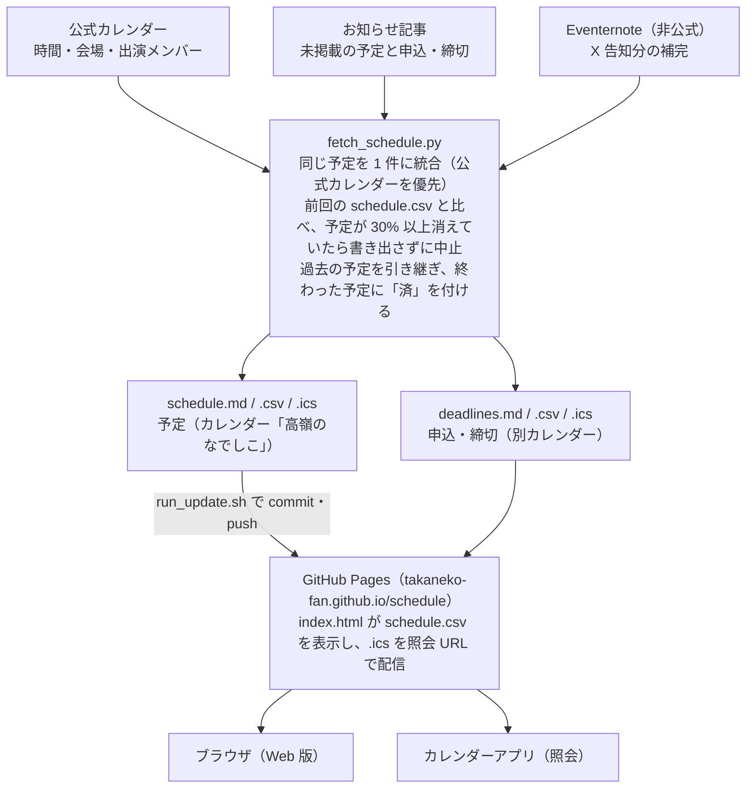

# schedule 仕様書

作成日: 2026-10-21

## 概要

高嶺のなでしこ（たかねこ）の出演・イベント予定を公式サイトなどから自動で集め、メンバー別のスケジュール一覧とカレンダー（iCalendar）を出力するファン向けの非公式ツールです。

| 項目 | 内容 |
| --- | --- |
| 対象ユーザー | 予定をカレンダーアプリで追いたいファン |
| 公開リポジトリ | [takaneko-fan/schedule](https://github.com/takaneko-fan/schedule) |
| 公開サイト | https://takaneko-fan.github.io/schedule/ （GitHub Pages） |
| 動作環境 | Python 3.10 以上、標準ライブラリのみ |
| 位置づけ | 非公式。予定は取得時点のもので、参加前に公式サイト・公式 X で確認が必要 |

## 全体構成



処理はすべて `fetch_schedule.py` 1 本で行い、`run_update.sh` が実行から push までをまとめます。申込・締切はお知らせ記事だけから読み取り、Eventernote の取得に失敗しても処理は続行します。

| ファイル | 役割 |
| --- | --- |
| `fetch_schedule.py` | 取得・統合・出力のすべて（約 890 行、標準ライブラリのみ） |
| `run_update.sh` | 取得 → 差分があればコミット・push（手動・cron 兼用） |
| `index.html` | GitHub Pages の Web 版（手書き） |
| `.devcontainer/` | 開発用の Python コンテナ定義 |

## データ仕様

予定データの正本は `schedule.csv` と `deadlines.csv` の 2 つです。どちらも UTF-8（BOM 付き）で、`schedule.csv` は次回実行時に過去の予定を引き継ぐ元にもなります。

### schedule.csv（予定）

| 列 | 内容 | 例 |
| --- | --- | --- |
| `done` | 終了済みなら「済」（開始日が今日より前） | 済 |
| `date` / `weekday` | 日付（YYYY-MM-DD）と曜日 | 2026-09-24 / 木 |
| `open` / `start` / `end` | 開場・開演・終了時刻（記載があるもののみ） | 18:00 |
| `time_note` | 部制イベントの時間 | 1部 12:30 START ／ 2部 16:00 START |
| `title` | イベント名 | ✿SPACE MAKE✿ |
| `category` | ライブ／イベント、メディア、誕生日、その他、お知らせ記事、Eventernote（非公式） | その他 |
| `members` | 出演メンバー（「、」区切り）。個別の記載がなければ「グループ（全員）」 | 城月菜央、松本ももな |
| `venue` | 会場 | |
| `url` | 情報元のページ | |

### deadlines.csv（申込・締切）

| 列 | 内容 |
| --- | --- |
| `done` | 済フラグ（schedule.csv と同じ） |
| `date` / `weekday` / `time` | 日付・曜日・時刻（時刻がなければ空） |
| `kind` | 種別：受付開始、受付締切、当落発表、入金締切、一般発売 |
| `event` | イベント名（記事タイトルから「高嶺のなでしこ」を除いたもの。日付付きの記事は「10/24 …」のように開催日を前置） |
| `detail` | 受付の区分（「FC先行受付」など記事中の見出し。なければ検出した見出し語） |
| `note` | 記事に書かれていた日時の原文 |
| `url` | 情報元の記事 |

### メンバー定義

メンバーは `fetch_schedule.py` の `MEMBERS` に公式サイトの掲載順で定義しています（城月菜央、涼海すう、橋本桃呼、葉月紗蘭、東山恵里沙、日向端ひな、松本ももな、籾山ひめり）。メンバーが変わったときはここを更新します。

## 出力仕様

1 回の実行で 6 つのファイルを書き出し、`index.html` がそのうち `schedule.csv` を読んで画面に表示します。

| ファイル | 用途 | 備考 |
| --- | --- | --- |
| `schedule.md` | メンバー別・日付順の一覧（読む用） | 終了済みは ✅ |
| `schedule.csv` | 加工用・Web 版のデータ源 | 過去分の引き継ぎ元 |
| `schedule.ics` | カレンダー「高嶺のなでしこ」 | 照会 URL: https://takaneko-fan.github.io/schedule/schedule.ics |
| `deadlines.md` | 申込・締切の一覧 | |
| `deadlines.csv` | 同じ内容の CSV | |
| `deadlines.ics` | カレンダー「高嶺のなでしこ 申込・締切」 | 照会 URL: https://takaneko-fan.github.io/schedule/deadlines.ics |
| `index.html` | GitHub Pages の Web 版 | 手書き。生成対象ではない |

### iCalendar の変換ルール

| 元データ | カレンダー上の予定 |
| --- | --- |
| 開演（または開場）時刻あり | 開演から。終了時刻がなければ 2 時間 |
| 部制（`time_note`） | 最初の部の開始〜最後の部の終了（不明なら最後の部の開始 + 2 時間） |
| 時刻なし | 終日の予定 |
| 個別メンバーの出演 | タイトル先頭に【城月・松本】のように姓を付ける |
| Eventernote（非公式） | 末尾に「（非公式）」、ステータス「仮」 |
| 申込・締切 | 「【受付締切】イベント名（区分）」。締切はその時刻に終わる 30 分、他はその時刻から 30 分。時刻なしは終日 |

- 時刻は日本時間（Asia/Tokyo）。予定は「空き時間」扱いで、個人の予定の空き状況に影響しません。
- 開場時刻・部ごとの詳細・出演メンバー・情報元 URL はメモ欄に入ります。
- UID は日付と URL のハッシュで、照会側で予定が重複しません。更新間隔の目安は 6 時間（`REFRESH-INTERVAL`）です。
- 内容が前回と同じなら `.ics` は書き直しません（実行時刻だけの差分でコミットが生まれないようにするため）。

### Web 版（index.html）

`schedule.csv` を読み込み、メンバー・カテゴリで絞り込んで表示します。メンバーを選んだときに「グループ（全員）」の予定を含めるか、終了済みを表示するかを切り替えられます。両カレンダーの照会ボタン（`webcal://`）と URL も載せています。

## 申込・締切の抽出

公式サイトのお知らせ記事（WordPress REST API、既定で過去 365 日分）を 1 行ずつ読み、「受付期間」などのラベルの後ろにある日時を種別ごとの予定にします。

| ラベル（正規表現の要旨） | 最初の日時 | 最後の日時 |
| --- | --- | --- |
| ○回目受付、受付／応募／抽選予約販売／先着販売／販売期間 | 受付開始 | 受付締切 |
| 受付締切、申請締切、締切 | 受付締切 | — |
| 当落・入金期間、抽選結果確認／入金期間 | 当落発表 | 入金締切 |
| 抽選結果（発表）、当選連絡 | 当落発表 | — |
| 当選分お支払い期限、支払期日、支払締切 | 入金締切 | — |
| チケット一般発売 | 一般発売 | — |
| 販売開始（LINE・オンライン・Web・ストア・サイトのみ） | 受付開始 | — |

### 読み取りの規則

1. 記事本文を NFKC で正規化し、行ごとにラベルを探す。その行に日時がなければ次の行を見る。
2. 期間ラベルで「〜で 23:59まで」のように終わりだけ書かれていれば、その日時を終わりの種別（受付締切など）にする。
3. 直前の見出し（【…】、■…、☆… など）のうち「受付・先行・抽選・予約・販売・特典会名」を含むものを区分（`detail`）にする。
4. 記事タイトルが「【10月24日(土)】…」のように始まる場合は、イベント名に開催日を付けて同名の別の回と区別する。
5. 種別・日時・イベントが同じものは 1 件にまとめる（新しい記事の記載を優先）。

### 除外するもの

- 店舗の電話受付時間、会場での当日販売（「受付時間」「当日」「会場」を含む行）
- 支払方法ごとの締切（見出しに「振込・ペイ・カード・コンビニ・決済」を含むもの）
- 記事の公開日より前の日付。公開から 30 日以内の記事で見つかった場合は公式の記載ミスの可能性として実行ログに警告を出す
- FC サイトやプレイガイドにしか載っていない受付、「翌日15:00まで」のような相対的な書き方の締切（読み取れない）

## 運用手順

更新は `run_update.sh` を 1 回実行するだけです。予定に変化があれば自動でコミット・ push され、GitHub Pages と照会カレンダーに反映されます。

1. `git pull --ff-only` で最新にする。
2. `python3 fetch_schedule.py` を実行する（`run_update.sh` の引数はそのまま渡る）。
3. `schedule.*` と `deadlines.*` の 6 ファイルを `git add` する。差分がなければ「予定に変化なし」で終了。
4. `feat: YYYY-MM-DDの登録`（日本時間の日付）でコミットし、push する。

### 主なオプション

| オプション | 説明 |
| --- | --- |
| `--start YYYY-MM-DD` | 開始日（既定: 今日） |
| `--end YYYY-MM-DD` | 終了日。この日は含まない（既定: 今日から 366 日後） |
| `--no-detail` | 詳細ページを取得しない（速いが時間・会場が空になる） |
| `--post-days N` | 何日前までのお知らせ記事を確認するか（既定: 365） |
| `--md` / `--csv` / `--ics PATH` | 出力先 |
| `--deadlines PATH` | 申込・締切の出力先（拡張子なし、既定: `deadlines`） |
| `--force` | 安全策のチェックを飛ばして出力する |

### 安全策

取得に失敗して予定を消したまま公開しないよう、書き出す前に前回の `schedule.csv` と比べ、次の場合はファイルを書き換えずにエラー終了します。

- 公式カレンダーから 1 件も取得できなかった
- 前回あった対象期間内の予定のうち 30% 以上（かつ 5 件以上）が見つからない（Eventernote の予定は比較しない）

本当に中止・削除された場合や期間を変えた場合は `--force` を付けて実行します。Eventernote の取得に失敗しても、補助的な取得元なので警告を出して続行します。

### コミット名義

コミットは `takaneko-fan <bot@example.invalid>` 名義で行います。このリポジトリの `.git/config` に `user.name` / `user.email` を設定済みで、個人のグローバル設定より優先されます。新しい環境で clone したときは同じ設定をやり直します。

```
git config --local user.name "takaneko-fan"
git config --local user.email "bot@example.invalid"
```

## 情報の取り扱い

掲載するのは公開情報のうち事実情報だけで、権利者などから要望があれば速やかに削除します。

- 高嶺のなでしこ・所属事務所・各サイトの運営とは関係のない、ファンによる非公式プロジェクトです。
- 掲載するのは日時・イベント名・会場・情報元へのリンクのみ。画像や告知文の転載はしません（申込・締切の `note` は日時部分の原文のみ）。
- 各取得元の利用規約と robots.txt に沿って、サーバーに負担をかけない頻度で取得します（2026年10月時点で確認）。User-Agent に `takaneko-fan/schedule` を名乗ります。
- 公式・権利者・各サイトの運営から掲載の停止や修正の要望があれば、速やかに対応・削除します。

未決事項：連絡先は README で「準備中」のままです。
