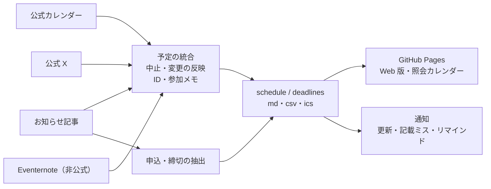

# 高嶺のなでしこ 非公式スケジュール 機能仕様書

## 0. 文書情報

| 項目 | 内容 |
| --- | --- |
| 作成日 | 2026-10-21 |
| 最終更新日 | 2026-11-20 |
| 対応するバージョン | v1.1.1（[変更履歴](../CHANGELOG.md)） |
| 公開リポジトリ | [takaneko-fan/schedule](https://github.com/takaneko-fan/schedule) |
| 公開サイト | https://takaneko-fan.github.io/schedule/ （GitHub Pages） |
| 関連文書 | [構想書](concept.md)（なぜ作るか・基本の考え方）／[設計](design.md)（関数・定数・AI への指示文など）／[運用](operations.md)（自動更新の仕組み・push・障害時の確認）／[VPS の構築手順書](vps-setup.md)／[検証記録・経緯](notes.md)／[処理の流れの図](flow.html) |

この文書は「何をするか」を定めます。「どう作っているか」は設計、「どう動かしているか」は運用の文書に書きます。

## 1. 目的と背景

高嶺のなでしこの予定は、公式サイトのカレンダー・お知らせ記事・公式 X の 3 か所に分かれて発表され、どれも単独では予定の全体と最新の状態が分かりません（カレンダーは遅く古い、お知らせは積み重なって埋もれる、公式 X は流れて公式サイトに反映されない）。
このツールは、3 か所の情報を自動で集め、予定・申込・締切・当日に必要なことを 1 か所で、最新の状態で、元の公式の発表をたどれる形で示し、変更と締切を見逃さないようにします。

背景、目的、基本の考え方（公式の情報に基づく、後から出た情報を最新とする、根拠をたどれるようにする、確かでないことは確かでないと示す、公式の発信を尊重する）は [構想書](concept.md) に書きます。この文書は、それを実現するために「何をするか」を定めます。

## 2. 範囲

### 2.1 対象

| 情報元 | 使い方 |
| --- | --- |
| 公式サイトのカレンダー | 予定の土台。時刻・会場・出演メンバー |
| 公式サイトのお知らせ記事 | カレンダーにない予定、ラジオ出演のまとめ、申込・締切、仮の会場の補完、参加メモの材料 |
| 公式 X（@takanenofficial） | カレンダーにまだない予定、中止・欠席・延期・変更の告知、告知画像（スケジュール一覧・タイムテーブル）、出演時間、参加メモの「📣 公式 X の最新情報」、申込・締切 |
| Eventernote（非公式） | 公式にまだない出演情報の補完 |

### 2.2 対象外

- メンバー個人の X、FC サイト、LINE、YouTube、プレイガイドにしか載っていない情報
- お知らせ記事・公式カレンダーのイベントページの画像（公式 X の告知画像は読む）
- 振替・延期の新しい日付（元の予定に【延期】を付けるところまで。新しい日付は新しい告知として扱う）
- 本文に中身がなく、リンク先にしか書かれていない変更の告知
- 「翌日15:00まで」のような相対的な書き方の締切
- 当日の告知で知った、メンバーが今いる場所の公開（9.5）

## 3. 利用者と利用の場面

利用者は、高嶺のなでしこの予定を追うファンです。

| 場面 | 使うもの | 機能 |
| --- | --- | --- |
| 予定をいつものカレンダーアプリで見たい | 照会カレンダー（`schedule.ics`） | F-11 |
| 申込・締切もカレンダーで見たい | 照会カレンダー（`deadlines.ics`） | F-10、F-11 |
| 推しメンバーの予定だけ見たい | Web 版の絞り込み、`schedule.md` | F-11、F-12 |
| 行く予定を決め、申込の期限を確かめ、自分のカレンダーに入れたい | Web 版の ★ 行く・申込・締切・カレンダーに追加 | F-12 |
| 当日に必要なこと（流れ・持ち物・料金）を知りたい | 参加メモ | F-09 |
| 予定の追加・変更・中止をすぐ知りたい | 更新の通知 | F-13 |
| 今日が締切の申込を忘れたくない | たかねこリマインド | F-15 |
| データを加工したい | `schedule.csv`、`deadlines.csv` | F-11 |

## 4. 全体像

1 回の更新は、取得（F-01〜F-04）→ まとめる（F-05〜F-10）→ 出す（F-11）→ 知らせる（F-13〜F-15）の順に進みます。更新は 1 日 8 回、自動で行います（F-17）。処理の細かい流れは [処理の流れの図](flow.html) にあります。

## 5. 機能一覧

| ID | 機能 | 概要 |
| --- | --- | --- |
| **取得** | | |
| F-01 | 公式カレンダーの取得 | 予定の一覧とイベントページから、時刻・会場・出演メンバーを読む |
| F-02 | お知らせ記事からの予定の取得 | 【開催日】の記事・月ごとのスケジュールをルールで読み、ラジオ出演のまとめなどは AI で読む |
| F-03 | 公式 X からの予定の取得 | 新しい予定の告知をルールで読み、読めなければ AI で読む |
| F-04 | Eventernote からの補完 | 公式にまだない出演情報を補う |
| **まとめる** | | |
| F-05 | 予定の統合 | 同じ予定を 1 件にまとめ、仮の会場を補い、番組の種別を付ける |
| F-06 | 中止・欠席・延期・変更の反映 | 公式 X の告知を読み、予定に印を付け、時刻・会場を書き換える |
| F-07 | 予定の ID の付与と引き継ぎ | 情報元が変わっても同じ予定には同じ ID を使う |
| F-08 | 過去の予定の引き継ぎ | 終わった予定を残し、「済」を付ける |
| F-09 | 参加メモ | 公式の案内を AI で要約し、当日に必要なことをまとめる |
| F-19 | 出演時間 | 対バン・フェスのタイムテーブルから、高嶺のなでしこの出演時間を読み、予定の時間に並べて出す |
| F-10 | 申込・締切の抽出 | お知らせ記事から受付・当落・入金・一般発売の日時を読む |
| **出す** | | |
| F-11 | 予定と申込・締切の出力 | 一覧（md）・CSV・照会カレンダー（ics）・1 件ずつの ics |
| F-12 | Web 版 | 一覧と絞り込み、★ 行く、申込・締切、カレンダーへの追加、他の端末への移し替え |
| **知らせる** | | |
| F-13 | 更新の通知 | 前後の更新を比べ、重要な変更・決定・件数に分けて知らせる |
| F-14 | 記載ミスの可能性の通知 | 申込・締切の公式の誤記らしきものを、記事ごとに 1 回知らせる |
| F-15 | たかねこリマインド | 今日締切の申込と、今日始まる先着販売を知らせる |
| F-18 | 会場を取り込めていない可能性の通知 | 公式が会場を発表しているのに、予定の会場が仮のままのときに知らせる |
| **動かす・守る** | | |
| F-16 | 安全策 | 取得に失敗して予定が大きく減ったときは、書き出さずに止める |
| F-17 | 定期更新と停止の検知 | 1 日 8 回更新し、止まったら知らせる |

## 6. 機能仕様

### F-01 公式カレンダーの取得

- **概要:** 公式サイトのカレンダーから、対象期間（既定は今日から 366 日後まで）の予定を取得する。
- **入力:** カレンダーの予定の一覧、各予定のイベントページ。
- **処理:**
  1. 予定ごとに日付・予定名・カテゴリ（ライブ／イベント、メディア、誕生日、その他）を得る。
  2. イベントページの本文から、開場・開演・終了時刻、部制の時間、会場、出演メンバーを読む。個別メンバーの記載がなければ「グループ（全員）」とする。
- **出力:** 予定の一覧（統合の土台。F-05）。
- **異常時:**
  - 予定の一覧が取得できなければ（通信の失敗、0 件）、何も書き換えずに更新全体を止める（F-16）。
  - イベントページの取得に失敗した予定は、全体を止めず、時刻・会場などを空のまま続ける。次の更新で取得できれば元に戻る。
- **補足:** 毎回すべて読み直すので、イベントページの時刻・会場が書き換わればそのまま反映される。

### F-02 お知らせ記事からの予定の取得

- **概要:** カレンダーにない予定や、カレンダーより先に出る予定を、お知らせ記事から読む。
- **入力:** 公式サイトのお知らせ記事（既定は過去 365 日分）。
- **処理:**
  1. **ルールで読む:** タイトルが「【10月24日(土)】…」で始まる記事、本文の行が日付で始まる記事（月ごとの「スケジュール公開！」など）から、日付と予定名を読む。販売・受付の告知は予定にしない。
  2. **AI で読む:** ルールで予定が 1 件も読めなかった記事（日付の見出しの下に時刻・出演者・番組が並ぶラジオ出演のまとめなど）を AI で読み、本文に書かれていることを確かめてから使う。一覧に入れるのはラジオ・テレビ・配信の番組だけ。
- **出力:** 予定の候補（F-05 で統合）。AI の読み取り結果は保存し、記事の本文が変わらなければ読み直さない（7.3）。
- **異常時:** お知らせ記事の一覧が取得できなければ、何も書き換えずに更新全体を止める。AI が使えないときは AI の部分だけ飛ばし、保存済みの読み取り結果を使う。

### F-03 公式 X からの予定の取得

- **概要:** 公式 X の告知から、公式サイトにまだ載っていない予定を読む。
- **入力:** 公式 X の、前回読んだ投稿より新しい投稿（リポスト・返信を除く）。
- **処理:**
  1. 1 行目が決まった形の中止・欠席の告知（F-06）は、新しい予定としては読まない。それ以外の投稿は新しい予定として読む。本文に変更・中止などの語を含む投稿は、あわせて F-06 の AI の読み取りにも回す。
  2. **ルールで読む:** 「🗓️11月14日(土)」のような日付の行と、その下の予定名・会場（📍）・時刻（⏰、OPEN/START）を読む。日付のない「#あしたのたかねこ」は翌日（日本時間 5 時より前の投稿は前日の夜の投稿とみなし、投稿日の当日）、「このあと」「本日」は当日の予定とする。
  3. **AI で読む:** ルールで確実に読めなかった投稿を AI で読み、日付・予定名・時刻・会場・メンバーが本文に書かれていることを確かめてから使う。ルールで読めた投稿でも、1 つの投稿に予定が複数並ぶ（「本日オンエア」に番組が 2 つなど）とルールが一部しか読めないことがあるので、AI だけが読めた予定（ルールのどの予定とも組にならず、予定名も重ならないもの）は足す。
  4. 販売・受付の告知、期間（日付が 2 つ）、発売日、投稿日より前の日付は予定にしない。
  5. **告知画像の一覧を読む:** 画像付きの告知（F-19 と同じ投稿）の画像を AI で 2 回読み、ラジオ出演・イベントのスケジュールなどの一覧にしかない予定（日付・時刻・局または会場・番組名やイベント名）を取り出す。2 回の読み取りで同じイベントと判断できたものだけ採り、内容は後に読み取ったものを使う。同じイベントかどうかは情報の一致具合で判断する（日付は必須、開始時刻・会場が両方にあれば一致も必須。そのうえで番組名・イベント名が近いか、開始時刻と局または会場が一致すれば同じ。名前が似ていても会場が違えば別）。会場があればライブ・イベント、局があれば番組とし、番組の種別（ラジオ・テレビ・配信）は局・番組名で決め、分からなければ投稿の本文で決める。番組名の小さな文字は読むたびに違うことがあるが、正しいかどうかは決められないので、最後に読み取った情報にする（後から公式の情報が出れば、そちらが優先される）。投稿日から 120 日以内のものだけ。出演は、名前が画像に書かれていない（顔写真だけ）ので「グループ（全員）」として扱い（名前の記載がない予定と同じ）、表示は「メンバー未記載」とする。種類に「画像読み取り」を付ける。同じイベントがほかの投稿の画像にもあれば、新しい投稿の読み取りを使う。タイムテーブルのほかのグループ、同じイベントの部ごとの時間は取らない。
  6. **当日の告知は公開しない:** 「このあと」「本日」の告知は、会場のないラジオ・テレビ・配信の番組を除き、一覧に入れない（9.5）。
- **出力:** 予定の候補（F-05 で統合）。投稿は一度しか読まないので、読み取った予定を保存し、毎回の更新で使う（7.3）。ただし、公式の予定と保存済みの予定に統合しても何も変わらない予定（公式に載っていて時刻・会場もそろっている予定の再告知など）は保存しない。公式にまだない予定と、公式の予定の空いている項目を補える予定は保存する。
- **異常時:** 取得に失敗したとき、トークンがないときは、保存済みの予定を使って続ける。AI の呼び出しに失敗した投稿は、次の更新で読み直す（一定回数で諦める）。

### F-04 Eventernote からの補完

- **概要:** 公式にまだない出演情報を、非公式のイベント情報サイトから補う。
- **出力:** 予定の候補。カテゴリは「Eventernote（非公式）」、カレンダーでは「仮」、予定名の末尾に「（非公式）」。
- **異常時:** 取得に失敗しても続ける。安全策（F-16）の比較の対象にしない。

### F-05 予定の統合

- **概要:** 複数の情報元に出た同じ予定を 1 件にまとめる。
- **処理:**
  1. 公式カレンダー → お知らせ記事 → 公式 X → Eventernote の順にまとめる。先の情報元を優先する。
  2. 同じ日付の予定のうち、どの予定にも付く語（グループ名、アルバム・シングル名、「リリース記念」「発売記念」など）を除いた予定名か会場に共通の語句がある予定を、同じ予定とみなす。見つからなければ、それらの語を除かずに比べるが、候補が 1 件に決まるときだけ使う（「個別特典会」と「個別イベント」のような言い換えを拾うため）。2 件以上なら取り違えないよう、まとめずに別の予定として残す。公式 X の予定は、投稿の『』の名前や会場名の一致でも同じとみなす。
  3. 公式 X の予定で、同じ予定とみなす候補が 2 件以上あるときは、取り違えないよう、まとめも追加もしない。お知らせ記事の予定は、最初の候補にまとめる。
  4. まとめるときは、先の情報元の値を優先し、次のものだけを後の情報元から取り込む。
     - 先の予定に時刻がまったくない（開場・開演とも空）ときに限り、空いている会場と部制の時間
     - 先の予定の会場が「東京都内某所」のような仮の会場なら、実際の会場（時刻の有無に関係なく置き換える）
     - 同じ会場でより詳しい会場名（「ららぽーと立川立飛」→「ららぽーと立川立飛2F イベント広場」）
     - 先の予定が「グループ（全員）」のときの、日ごとの担当メンバー（会場か、どの予定にも付く語を除いた予定名が一致する、または記事の本文に公式の予定名がそのまま出てくる、確かに同じ催しのときだけ）
     - 公式 X の投稿から判定した番組の種別（ラジオ・テレビ・配信）
     - 公式 X の予定どうしでは、空いている開場・開演・終了・部制の時間・会場
  5. 発売日の行と、店舗のキャンペーン・特典の配布（「キャンペーン」「レシート」「ポスター」など）は、その日のイベントとは別の予定として残す。
  6. **仮の会場を補う:** 会場が「東京都内某所（詳細は後日発表）」のような予定は、同じ日付の記事のタイトル（「… at 会場名」）や本文（「【会場】…」「会場：…」、「■会場」の見出しの次の行）から会場名を補い、補った記事を「会場の情報元」として残す。
  7. **詳細が記事にだけある予定:** 公式カレンダーのイベントページが「詳細は後日発表」だけで、同じ日付の記事に詳細が出ている予定は、情報元をその記事に切り替える（新しい記事を優先）。公式がイベントページを書き換えれば元に戻る。ID は元のイベントページから作ったまま変えない（F-07）。
  8. **番組の種別:** ラジオ・テレビ・配信の番組には種別を付け、表示で【ラジオ】のように先頭に出す（種別は予定名には入れない）。AI で読んだ番組は、予定名の末尾に放送局を付ける（「ラジオ土曜便（岐阜放送）」）。
- **出力:** 統合された予定の一覧。

### F-06 中止・欠席・延期・変更の反映

- **概要:** 公式 X の中止・欠席・延期・変更の告知を読み、予定に反映する。公式カレンダーは中止や変更を反映しないことが多いため、この機能で補う。
- **入力:** 公式 X の投稿、統合された予定。
- **処理:**
  1. **決まった形の告知（ルール）:** 1 行目が「○○欠席のお知らせ」「【イベント中止のお知らせ】」「【ミニライブ中止のお知らせ】」などの投稿から、日付（本文の日付、なければ「本日」「明日」）、予定名（『』「」の中）、欠席するメンバー、代わりに出るメンバーを読む。日付が読めない告知（本文がリンクだけなど）は使わない。
  2. **書き方の決まっていない告知（AI）:** 本文に「変更・中止・欠席・延期・見合わせ」などを含む投稿を、前後の予定の一覧と一緒に AI で読み、種類・対象の予定・変更後の値・根拠の一文を得る。次の場合は使わない。
     - 注意書き（「中止となる場合があります」「予定通り開催します」「変更はございません」）
     - 根拠の一文・日付・変更後の値・メンバーが本文に書かれていない
     - 対象の予定が決まらない、日付が予定と合わない、終わった予定
  3. **反映:**

     | 告知 | 予定への反映 |
     | --- | --- |
     | 中止 | 予定名の先頭に【中止】。カレンダーでは「キャンセル」 |
     | 一部の中止 | 予定名の先頭に【ミニライブ中止】など |
     | 延期 | 予定名の先頭に【延期】。カレンダーでは「キャンセル」 |
     | 欠席 | 予定名の先頭に【城月欠席】など。個別メンバーの予定なら、欠席するメンバーを外し、代わりのメンバーを足す |
     | 時刻・会場の変更 | 公式の値が変更前のままなら、変更後の値に書き換える。すでに変更後の値なら何もしない。どちらとも違えば、公式が後から変わったとみなして公式の値を使う |

  4. 対象の予定は、ルールの告知では告知の予定名と予定名の一致（一致がなく、その日の予定が 1 件だけならその予定）、AI の告知では読んだときの予定（情報元か予定名が同じもの）で決める。決まらなければ反映せず、実行ログに出す。
- **出力:** 印の付いた予定、書き換えた時刻・会場。読み取った告知は保存し、予定の日付が過ぎたら消す（7.3）。
- **異常時:** AI が使えないときは、ルールの分だけ反映する。
- **対象外:** 2.2 のとおり（振替の新しい日付、リンク先にしか書かれていない変更など）。

### F-07 予定の ID の付与と引き継ぎ

- **概要:** 予定ごとに ID を付ける。ID は照会カレンダーの予定の識別、Web 版の ★ の印、1 件ずつの ics のファイル名に使う。
- **処理:**
  1. ID は日付と情報元から作る。同じ日・同じ情報元の予定が複数あれば、予定名で区別する。
  2. 情報元が変わった予定（公式 X → 公式カレンダーなど）は、前回の ID を引き継ぐ。前回あって今回消えた予定のうち、同じ日付で、予定名か会場が近いもの（公式 X の予定がまとめられた場合は元の投稿）を同じ予定とみなす。
  3. 取り違えを防ぐため、候補が 2 件以上ある場合や、日付が変わった場合は引き継がない。
- **目的:** 情報元が変わるたびにカレンダーの予定が作り直されたり、★ の印が外れたりしないようにする。

### F-08 過去の予定の引き継ぎ

- 開始日より前の予定は、前回の出力（`schedule.csv`）からそのまま引き継ぐ。終わった予定は消さず、「済」を付ける（当日の予定にはまだ付けない）。
- `schedule.csv` を消すと、過去の予定は引き継がれない。

### F-09 参加メモ

- **概要:** これからの予定のうち、公式の案内がある予定に、当日に必要なことの要約を付ける。案内文の転載はしない。
- **入力:** その予定のイベントページの本文と、関係するお知らせ記事（情報元・会場の情報元の記事と、開催日と予定名が一致する記事。情報元でない記事は、同じ日の予定のうち一番よく一致する予定（名前の共通部分が一番長く、同じなら名前に占める割合が一番大きい予定）にだけ使う。「ニューアルバム『…』」のような共通の語だけで、同じ日の店舗のキャンペーンなどに混ざらないように）。個人情報の取り扱い・問い合わせ先などの定型文は除く。
- **項目:** 📍 会場、🕙 当日の流れ、👥 部とメンバー、🎫 参加方法・当日券、💴 料金、💳 支払い、🎒 持ち物、📸 ルール、⚠️ 注意、ℹ️ その他。この順に並べる。
- **後から出た情報を最新とする:** 公式のお知らせ・イベントページと公式 X で同じ項目の値が食い違うときは、情報元の種類に関係なく、後から出た方を採る。
  - 公式 X の投稿の方が後なら、その項目の値を置き換え「（11/16 の公式 X で変更）」を付ける（値がそのまま見つからなければ、項目の最後に「※11/16 の公式 X で変更: …」と注記する）。
  - 公式の値の方が後、または差が 1 時間以内（同時の告知）なら、公式の値を残す。
  - 公式の値が出た日時は、定期の更新で読んだ記事・イベントページの本文の版を記録し、その値が載った最初の版を見た日時とする（1 日 8 回の更新の間隔の精度）。記録を始める前からある値は、お知らせ記事は公開日時、イベントページは前に参加メモを作った日とみなす。値が見つからなければ、情報元の今の版の日時とする（公式を残す側に倒す）。
  - どちらが後かは、AI ではなくプログラムが日時で決める。公式 X の投稿どうしで食い違うときは、新しい投稿を採る。
- **📣 公式 X の最新情報:** 公式の案内の要約（上の項目）は崩さず、その後に、関係する公式 X の投稿にしか書かれていない情報（出演時刻、物販の時間、売り切れ・残りわずか、追加販売、当日の変更など）を「📣 公式 X の最新情報」として足す。各項目に「（10/23 の投稿）」のように投稿日を付ける。
  - 関係する投稿: 予定の日付が書かれている（または当日の「本日」、前日の「明日」の）投稿で、予定名か会場が本文にあるもの。店舗のキャンペーンだけの投稿（レシート・パネル展などで、ミニライブ・特典会・開演などの言葉がない）は、同じ店で開くイベントの投稿にしない。ただし、その日付のこれからの予定が 2 件以上ある投稿は、どの予定についての投稿かを AI で判断する（1 つの投稿が同じ日の複数のイベントを並べることや、書き方の違い（「個別握手会」と「個別特典イベント」）があるため）。AI には投稿と候補の予定を渡し、予定ごとにその予定について書かれた部分も返させる。答えの番号が候補にあることをプログラムで確かめ、判断の結果（投稿の一部を含むので公開しない）を定期の更新を動かす環境に保存して、投稿と候補が変わらなければ使い回す。判断できなかったときはルールで結び付ける。出演時間（F-19）の結び付けにも同じ判断を使う。
  - 参加メモと予定の行（日付・開場・開演・終演・会場）にすでに書かれていること、セットリスト、終演後のお礼やレポート、作った日より前に終わった受付・販売は書かない。
  - 公式 X にしかない予定（公式の案内がない予定）は、この項目だけの参加メモになる。
  - **根拠の投稿へのリンク:** 参加メモの最後（注意書きの前）に「🔗 公式 X: 11/14 URL ／ 11/15 URL」と、📣・変更・出演時間（F-19）の根拠の投稿の URL を投稿ごとに 1 回だけ並べる（出演時間の根拠は「出演時間 10/23 URL」、📣 と同じ投稿なら「10/23・出演時間 URL」）。同じ日の投稿が 2 つ以上あれば「11/14 21:00」のように時刻を付けて区別する。Web 版と `schedule.md` では、この行は出さず、各項目の「11/14 の投稿」「11/15 の公式 X」と「🎤 出演 …」をその投稿へのリンクにする。カレンダーのメモ欄と CSV には URL の行がそのまま入る。
  - 投稿の本文は、リポジトリの外（定期の更新を動かす環境）にだけ保存し、公開しない（9.5）。関係する投稿が増えた・変わったときだけ作り直す。
- **作り方の決まり:**
  - 案内文に書かれている事実だけを使い、書かれていない項目は空にする。
  - 情報元どうしで内容が食い違う場合は、公開日が新しいお知らせ記事の内容を書く。
  - 日時・時刻・金額・枚数・締切は案内文のとおりに書く。受付時間と締切、本人確認、入場条件、持ち込みの制限、払い戻しの不可などは、短さより優先して書く。
  - 締切が過ぎた販売・受付は書かなくてよい。
- **対象外:** 過去の予定、誕生日、Eventernote、発売日の行、番組（ラジオ・テレビ・配信）。公式の案内の要約は、公式 X だけの予定、材料が少なすぎる予定、「後日発表」だけの予定にも付けない（「📣 公式 X の最新情報」は付けられる）。店舗のキャンペーンの行には「📣 公式 X の最新情報」を付けない（日ごとの行に同じ内容が並ぶため）。
- **出力:** カレンダーのメモ欄、`schedule.md` の「参加メモ」節、Web 版の「参加メモ」、`schedule.csv` の `memo` 列。どれにも「公式の案内を AI が要約したものです。必ず情報元で確認してください。」（📣 の項目があるときは「公式の案内と公式 X の投稿を AI が要約したものです。…」）を付ける。
- **異常時:** AI が使えないとき、呼び出しに失敗したときは、前回のメモを使う。材料が変わらなければ作り直さない。投稿の本文を保存していない環境（手元など）では、前回の 📣 の項目をそのまま使う。

### F-10 申込・締切の抽出

- **概要:** お知らせ記事と公式 X の告知から、チケットや特典会の申込に関する日時を読む。
- **入力:** お知らせ記事（既定は過去 365 日分）と、公式 X の投稿（本文と告知画像から読んだ情報。投稿日から 120 日以内）。
- **種別と元になる記載:**

  | 記載（例） | 最初の日時 | 最後の日時 |
  | --- | --- | --- |
  | ○回目受付、受付期間、応募期間、抽選予約販売期間、先着販売期間、販売期間 | 受付開始 | 受付締切 |
  | 受付締切、申請締切、締切 | 受付締切 | — |
  | 当落・入金期間、抽選結果確認／入金期間 | 当落発表 | 入金締切 |
  | 抽選結果発表、当選連絡 | 当落発表 | — |
  | 当選分お支払い期限、支払期日、支払締切 | 入金締切 | — |
  | チケット一般発売 | 一般発売 | — |
  | 販売開始（LINE・オンライン・Web・ストア・サイトでの販売のみ） | 受付開始 | — |

- **処理:**
  1. 記載の後ろ（なければ次の行）の日時を読む。期間で終わりだけ書かれていれば（「〜23:59まで」）、終わりの種別にする。
  2. 直前の見出し（「FC先行受付」など）を受付の区分にする。記事が「【10月24日(土)】…」で始まる場合は、イベント名に開催日を付けて別の回と区別する。
  3. 何のイベントの何の期限かが分かる表示用の名前（「抽選の締切」「先着販売の開始」、「11/20 発売記念オンラインサイン会」）を作る。
  4. 種別・日時・イベントが同じものは 1 件にまとめる（新しい記事を優先）。
- **除外するもの:**
  - 店舗の電話受付時間、会場での当日販売
  - 支払方法ごとの締切（振込・ペイ・カード・コンビニ・決済）
  - 記事の公開日より前の日付（前の回の告知が残ったもの、または誤記）。ただし受付期間の途中で公開された記事の受付開始は残す。最近の記事でこの除外があれば、記載ミスの可能性として知らせる（F-14）
- **公式 X の申込・締切:** 記事に載らない受付（他団体のイベントのチケット受付、追加販売、グッズの通信販売など）を読む。
  1. 受付・販売・先行・抽選・締切・予約・申込の語と日付がある投稿だけ、AI で読む（新しい投稿から、1 回の更新で 20 件まで）。種別（上と同じ 5 種類）、日時、イベント名と開催日、受付の区分、日時の書き方を返させる。期間は受付開始と受付締切の 2 つにする。会場での当日販売・物販、開場・開演、発売日は読まない。
  2. 日付と時刻が本文にあること、受付開始などが投稿日より前でないことを、プログラムで確かめる（「各部開始10分後まで」を「23:59」と補ったものなどを除く）。
  3. 結果は投稿ごとに `x_deadlines.json`（リポジトリ。本文は含めない）に保存し、本文が変わらなければ読み直さない。
  4. 記事の申込・締切と種別・日時が同じで、開催日が同じかイベント名が重なるものは、同じ申込として足さない（記事の行を残す）。日時が食い違う場合（延長など）は両方が残る（後から出た方だけを残す扱いは、食い違いの実例が出てから決める）。情報元は公式 X の投稿。
- **出力:** 申込・締切の一覧（F-11）。Web 版では予定ごとに結び付けて表示する（F-12）。

### F-11 予定と申込・締切の出力

| 出力 | 内容 |
| --- | --- |
| `schedule.md` | メンバー別・日付順の一覧（読む用）。終わった予定は ✅。参加メモの節 |
| `schedule.csv` | 加工用・Web 版のデータ。次回の更新で過去の予定を引き継ぐ元（7.1） |
| `schedule.ics` | 照会カレンダー「高嶺のなでしこ」 |
| `deadlines.md` / `.csv` | 申込・締切の一覧（7.2） |
| `deadlines.ics` | 照会カレンダー「高嶺のなでしこ 申込・締切」 |
| `events/<ID>.ics` | これからの予定 1 件ずつ（Web 版の「カレンダーに追加」用）。終わった予定・消えた予定のファイルは消す |

**カレンダーの予定への変換:**

| 元の予定 | カレンダーの予定 |
| --- | --- |
| 開演（または開場）時刻あり | 開演から。終了時刻がなければ 2 時間 |
| 部制 | 最初の部の開始から最後の部の終了まで（終了が分からなければ最後の部の開始 + 2 時間） |
| 時刻なし | 終日 |
| 個別メンバーの出演 | 予定名の先頭に【城月・松本】のように姓 |
| ラジオ・テレビ・配信 | 予定名の先頭に【ラジオ】など |
| 中止・延期・欠席など | 予定名の先頭に【中止】などを最初に付ける。【中止】【延期】は「キャンセル」 |
| Eventernote | 末尾に「（非公式）」、状態は「仮」 |
| 申込・締切 | 「【受付締切】イベント名」。締切はその時刻に終わる 30 分、ほかはその時刻から 30 分。時刻なしは終日 |

- 時刻は日本時間。予定は「空き時間」として扱い、個人の予定の空き状況を塞がない。
- 開場時刻・部ごとの時間・出演メンバー・情報元・会場の情報元・参加メモは、メモ欄に入れる。
- 照会カレンダーの更新間隔の目安は 6 時間。
- カレンダー（ics）は、内容が前回と同じなら書き直さない（作成時刻だけの違いでコミットを作らない）。md・csv は毎回書き出すが、内容が同じなら差分は出ない。
- 1 件ずつの ics は、照会カレンダーとは別の予定として扱われるようにする（両方に入れても上書きし合わない）。

### F-12 Web 版

- **概要:** `schedule.csv` と `deadlines.csv` を読み、予定を一覧で表示する（GitHub Pages）。

| 機能 | 仕様 |
| --- | --- |
| 絞り込み | メンバー（1 人）、カテゴリ（複数選択可）。メンバーを選んだときに「グループ（全員）」の予定を含めるか、終わった予定を表示するかを切り替えられる |
| 照会カレンダー | 2 つのカレンダーの照会ボタンと URL |
| ☆ 行く | これからの予定（今日を含む）だけに表示。押すと「行く」の印を付ける |
| ★ 行く予定だけ | 「行く」の予定のうち、これからのものだけを表示する（この間は絞り込みを使わない） |
| 申込・締切 | 予定ごとに、結び付いた申込・締切を折りたたみで表示する。見出しに件数と次にやること（「申込・締切 3 件（次: 抽選の締切 11/12）」）を出す。「行く」の予定で、まだ先の項目があれば最初から開く。各項目は情報元の記事へのリンク。過去の項目は取り消し線、次にやることは太字。1 つの予定に別のイベント（サイン会とお話し会など）の申込が結び付くときは、区別の名前（「サイン会」「お話し会」）を添える |
| カレンダーに追加 | これからの予定ごとに、1 件ずつの ics を開く。押すと「追加済み」の印を付ける |
| まとめてカレンダーに追加 | 「行く」かつ未追加の予定をまとめて 1 つの ics として保存させ、「追加済み」にする |
| 追加済みの印を消す | これからの「行く」の予定の「追加済み」をすべて消す |
| 移すリンク | 「行く」の印を他の端末・ブラウザに移すリンクをコピーする。開いた側では「行く」に追加する（既存は消さない。「追加済み」は移さない） |
| 参加メモ | 折りたたみで表示する。項目ごとの見出しを付け、文ごとに分けて箇条書きにし、時刻と金額を太字にする。URL はリンクにする |
| 情報元、会場の情報元 | リンクで表示する |
| 地図 | 会場名から地図（Google マップの検索）を開くリンクを付ける。仮の会場・オンライン・未定の会場には付けない |

- **印の保存:** 「行く」「追加済み」の印は、そのブラウザの中にだけ保存し、サーバーには送らない。終わった予定と一覧から消えた予定の印は、読み込んだときに消す。★ を外しても「追加済み」は残す（付け直したときに二重に入れないため）。
- **申込・締切の結び付け:** 申込・締切のイベント名と予定名の共通部分で判定する。開催日の付いたもの（「10/24 …」）は月日が一致し 6 文字以上、付いていないものは 8 文字以上の共通部分。予定の日付より後、または 150 日より前の申込・締切と、誕生日の予定は結び付けない。1 つの申込・締切は、結び付けられる予定のうち一番よく一致する予定（共通部分が一番長く、同じなら名前全体に占める共通部分の割合が一番大きいもの。同点ならそのすべて）にだけ結び付ける（「ニューアルバム『…』」のような共通の語だけで、同じ日のほかの予定に結び付かないように）。申込・締切の元の記事・投稿が予定の情報元（または会場の情報元）と同じなら、名前によらずその予定に結び付ける。開催日の付いていない申込・締切は、毎月のオンラインお話し会のように同じ名前の回がいくつもあるので、別の記事から作られた予定には結び付けず、同点で何月の回か分からなければ、どの予定にも結び付けない。自動で結び付けている旨の注意書きを付ける。
- 利用者向けの使い方は README に書く。

### F-13 更新の通知

- **概要:** 予定に変化があった更新のたびに、変化をまとめて 1 件の通知で知らせる（ntfy）。
- **比べ方:** 前回と今回の `schedule.csv`・`deadlines.csv` を比べる。今日より前の日付の行、「済」が付いただけの変化、申込・締切の削除は知らせない。
- **区分:**

  | 区分 | 対象 | 通知 |
  | --- | --- | --- |
  | ⚠️ 重要な変更 | 中止・延期・欠席の印が付いた、日付の変更、書かれていた時刻・出演時間の変更、別の会場への変更、出演メンバーの変更、削除 | 題名を「予定の変更あり」にし、優先度を上げる。変更前→変更後を書く |
  | ✅ 決定・追記 | 空だった時刻・出演時間・会場が決まった（「東京都内某所」のような仮の会場を含む）、会場の表記が詳しくなった、全員から個別のメンバーになった | 通常の優先度で、決まった内容を書く |
  | 件数だけ | 新しい予定、参加メモなどの変更、申込・締切の追加 | 件数と予定名（数件まで） |

- **同じ予定の判定:** ID が変わっても、同じ情報元か同じ日付で予定名が近ければ、同じ予定の変更として扱う。
- **本文:** Apple Watch でも読めるよう、予定名からグループ名・アルバム名などを省き、長い値は切る（予定名は 28 文字まで）。本文に出すのは、重要な変更 5 件、決定・追記 3 件、予定名 3 件までで、超えた分は「ほか○件」にまとめる。
- **異常時:** 通知に失敗しても更新は失敗にしない。更新そのものの失敗は別に知らせる（F-17）。

### F-14 記載ミスの可能性の通知

- **概要:** 申込・締切の抽出（F-10）で、最近（公開から 30 日以内）の記事に公開日より前の日付があり除外したとき、公式の誤記の可能性として知らせる。除外した日付は申込・締切にもリマインドにも入らないため、公式の記事で正しい日付を確かめてもらう。
- **タイミング:** 予定の変化に関係なく、更新のたびに確かめる。同じ項目は 1 回だけ知らせる（記事の取得に失敗した回のあとも送り直さない）。
- **本文:** 記事ごとに、イベント名と「・入金締切 10/12(月) 23:59 ← 記事の公開日（10/14）より前」を並べる。1 記事ならタップでその記事を開く。

### F-15 たかねこリマインド

- **概要:** その日に申込で動く必要があるものを、更新の通知とは別の通知先に知らせる。
- **対象:** 今日の受付締切・入金締切と、今日始まる先着販売。
- **タイミング:** 日本時間 9 時以降の最初の更新（深夜の更新では送らない）。同じ日にあとから増えた項目は、次の更新でその分だけ送る。同じ項目は 2 回送らない。
- **本文:** 「📅 今日（11/15）の申込」に続けて、1 件を「▶ イベント名」と「　何の期限か 時刻」の 2 行で時刻順に書く。4 件を超える分は「ほか ○ 件は Web 版で確認してください」。

### F-19 出演時間

- **概要:** 対バン・フェスなど複数のグループが出るイベントで、イベント全体の開場・開演とは別に、高嶺のなでしこがステージに立つ時間（出演時間）を予定に付ける。
- **入力:** 公式 X の投稿の本文と、告知画像（タイムテーブル・フライヤー・スケジュール一覧）。
- **処理:**
  1. **本文:** 「#高嶺のなでしこ 出演 19:50〜20:15」「🎤19:55~20:25」の形を読む。1 つの投稿に違う時間が 2 つ以上あれば（複数日・複数ステージ）読まない。予定との結び付けは参加メモの 📣 と同じ（日付と予定名・会場）。
  2. **告知画像:** 本文に「タイムテーブル」「出演情報」「きょうの／あしたのたかねこ」「Schedule」「リリイベ情報」「物販」「グッズ」などの言葉があり、画像が付いた投稿だけ、画像を AI で 2 回読む。出演時間は 2 回とも同じで、開始と終了がそろったものだけ採る（小さな文字の読み違いを除く）。単独公演・リリースイベントのミニライブや特典会の時間、ほかのグループの時間は採らない。予定には、投稿の本文に予定名・会場があるか、その日の対象の予定が 1 件だけのときに結び付ける。
  3. 新しい投稿の出演時間を採る。
- **出力:** 予定の時間の後ろに「🎤 出演 19:50〜20:15」を出す（一覧の md、Web 版、カレンダーのメモ欄の「時間」。Web 版では強調する）。md と Web 版では根拠の投稿へのリンクにする（参加メモの「🔗 公式 X」の行。F-09）。`schedule.csv` の `perform` 列（例 `19:50-20:15`）。カレンダーの予定の時刻はイベント全体の時刻のままにする。出演時間が決まった・変わったときは更新の通知で知らせる（F-13）。
- **画像のほかの情報:** 画像から読んだ物販・特典会の時間と場所、料金などは、参加メモの「📣 公式 X の最新情報」の材料にする（F-09）。メンバーは顔写真からは読まない。
- **対象外:** 過去の予定、誕生日、Eventernote、発売日の行、番組、店舗のキャンペーン。
- **異常時:** 投稿の記録がない環境（手元など）では、前回の結果（`perform.json`）を使う。画像の読み取りに失敗した投稿は読み直さない。

### F-18 会場を取り込めていない可能性の通知

- **概要:** 会場が仮（「東京都内某所」など）のままの予定について、公式の記事や公式 X に実際の会場らしき記載があるのに取り込めていないとき、取りこぼしとして知らせる。読み取りの決まりが知らない書き方に出会っても、気づけるようにするための安全網。公式がまだ会場を発表していないときは知らせない。
- **入力:** 統合と告知の反映が終わった予定、お知らせ記事、今回の更新で読んだ公式 X の投稿。
- **処理:**
  1. 対象は、これからの予定のうち、会場が仮のままの予定（誕生日・番組を除く）。
  2. 同じ日付の記事（日付と予定名が一致するもの）のタイトルの「at …」と、本文の会場の見出し（「■会場」「▼会場」「【会場】…」「会場：…」「場所：…」「開催場所：…」。読み取りの決まりより広い形）を手がかりにする。
  3. 今回読んだ公式 X の投稿の「📍…」の行を、直前の日付の行と組にして手がかりにする。同じ日のほかの予定の会場と一致するものは、その予定の告知とみなして除く。
  4. 手がかりの値が仮の会場でなければ、取り込めていない可能性として扱う。
- **出力:** 更新の通知と同じ通知先に、記載ミスの可能性（F-14）とは別の通知で、予定ごとに手がかりの記事・投稿を並べて知らせる。同じ予定と同じ記事・投稿の組は 1 回だけ知らせる（予定の日付から 30 日たつまで記録する）。
- **対象外:** 📍も会場の見出しもなく文章の中に会場名だけがある告知、時刻の取りこぼし。

### F-16 安全策

- 取得に失敗して予定を消したまま公開しないよう、書き出す前に前回の `schedule.csv` と比べ、次の場合は何も書き換えずに失敗として止める。
  - 公式カレンダーから 1 件も取得できなかった
  - 前回あった対象期間内の予定の 30% 以上（かつ 5 件以上）が見つからない（Eventernote の予定は比べない）
- 本当に中止・削除された場合や期間を変えた場合は、手で安全策を飛ばして実行する（運用の文書）。
- 公式 X・Eventernote・AI の失敗では止めず、警告を出して続ける。

### F-17 定期更新と停止の検知

- 日本時間 0:17 / 9:17 / 12:17 / 16:17 / 18:17 / 20:17 / 21:17 / 22:17 の 1 日 8 回、F-01〜F-15 を実行する。お知らせ記事の多くが夕方から夜に公開されるため、夜に寄せている。
- それとは別に、10 分ごとに公式 X の新しい投稿を確かめ、あれば「公式 X だけ」の更新をする（当日の中止・変更、先着販売の開始、売り切れなどを早く反映するため）。公式サイトにはアクセスせず、直前の全体の更新で取った内容を使って、全体の更新と同じ処理をする。新しい投稿がなければ何もしない。
- 予定に変化があれば、出力をコミットして公開する（Web 版・照会カレンダーに反映される）。
- 更新が失敗したら知らせる。更新が動いていない（連絡が途絶えた）ことも、外部の監視で知らせる。
- 仕組み（起動の方法、実行場所、名義）は運用の文書に書く。

## 7. データ定義

### 7.1 `schedule.csv`（予定）

UTF-8（BOM 付き）。日付順で、同じ日は開始時刻順（開始時刻がなければ開場時刻、部制は最初の部、時刻が分からない予定はその日の最後）。

| 列 | 内容 | 例 |
| --- | --- | --- |
| `done` | 終わった予定なら「済」 | 済 |
| `date` / `weekday` | 日付（YYYY-MM-DD）と曜日 | 2026-09-24 / 木 |
| `open` / `start` / `end` | 開場・開演・終了時刻（記載があるもの） | 18:00 |
| `time_note` | 部制の時間など | 1部 12:30 START ／ 2部 16:00 START |
| `title` | 予定名。中止・欠席などの印を先頭に含む。AI で読んだ番組は末尾に放送局を含む | 【中止】ミニライブ&特典会 |
| `category` | ライブ／イベント、メディア、誕生日、その他、お知らせ記事、公式X、Eventernote（非公式）。番組なら「 / ラジオ」など、AI で読んだ予定なら「 / AI読み取り」、公式 X の告知画像の一覧から読んだ予定なら「 / 画像読み取り」が続く | 公式X / ラジオ |
| `members` | 出演メンバー（「、」区切り）。個別の記載がなければ「グループ（全員）」 | 城月菜央、松本ももな |
| `venue` | 会場 | |
| `url` | 情報元 | |
| `venue_url` | 会場を別の記事から補った場合、その記事 | |
| `memo` | 参加メモ（1 行 1 項目、最終行は注意書き） | |
| `uid` | 予定の ID（F-07） | 070bcf4a728c51f6 |
| `perform` | 高嶺のなでしこの出演時間（F-19。2026-11-18 に最後に足した列） | 19:50-20:15 |

### 7.2 `deadlines.csv`（申込・締切）

| 列 | 内容 |
| --- | --- |
| `done` | 「済」（7.1 と同じ） |
| `date` / `weekday` / `time` | 日付・曜日・時刻（時刻がなければ空） |
| `kind` | 受付開始、受付締切、当落発表、入金締切、一般発売 |
| `event` | イベント名（開催日の付いた記事は「10/24 …」） |
| `detail` | 受付の区分（「FC先行受付」など） |
| `note` | 記事に書かれていた日時の原文（日時の部分だけ） |
| `url` | 情報元の記事 |
| `label` | 何の期限か（「抽選の締切」「先着販売の開始」など） |
| `time_text` | 時刻の表記（「21:00〜」「23:59まで」「各部開始10分後まで」） |
| `event_short` | アルバム名などを除いた短いイベント名 |

### 7.3 保存データ（リポジトリに入れるもの）

| ファイル | 中身 | 消すとき |
| --- | --- | --- |
| `x_events.json` | 公式 X から読み取った予定（日付・予定名・会場・時刻・メンバー・投稿の URL と日時） | 予定の日付が過ぎたら |
| `x_notices.json` | 公式 X の中止・欠席・延期・変更の告知（種類・印・対象の予定・変更前後の値・投稿の URL と日時） | 予定の日付が過ぎたら |
| `post_ai.json` | お知らせ記事の AI 読み取り結果（記事ごと） | 記事が取得範囲から外れたら |
| `memos.json` | 参加メモ（予定ごと） | 予定が終わったら（CSV には残る） |

どれも投稿・記事の本文は保存しない（9.5）。読んだ時点の記録の置き場所（リポジトリの外）は設計の文書に書く。

## 8. 外部とのつながり

| 相手 | やりとり | 失敗したとき |
| --- | --- | --- |
| 公式サイト（カレンダー・イベントページ・お知らせ記事） | 読むだけ | カレンダーの一覧かお知らせ記事の一覧が取れなければ、何も書き換えずに更新を止める。イベントページの取得に失敗した予定は、時刻・会場を空のまま続ける（F-01） |
| X API | 公式 X の投稿を読む（従量課金） | 保存済みの予定と告知で続ける |
| Eventernote | 出演情報を読む | 続ける |
| OpenAI または Gemini | 記事・投稿・案内文を渡し、読み取り・要約を受け取る | AI の部分だけ飛ばす。保存済みの結果を使う |
| ntfy | 通知を送る | 更新は失敗にしない |
| healthchecks.io | 更新の成功・失敗を連絡する | 更新は失敗にしない |
| GitHub（リポジトリ・Actions・Pages） | 出力をコミットして公開する | 更新の失敗として知らせる |

## 9. 非機能要件

このツールは、人の手をかけずに動き続け、費用を抑えて続けられることを前提とする。

### 9.1 鮮度

- 1 日 8 回、すべての情報元を更新する。更新の間隔は最大 9 時間（0:17〜9:17）。
- 公式 X の新しい投稿は 10 分ごとに確かめ、投稿から 10 数分ほどで反映する（F-17）。
- 公式 X の告知は、公式カレンダーより数日〜2 週間早く載せられる。

### 9.2 止まったときの検知

- 更新の失敗は、GitHub からのメールと通知で知らせる。
- 更新が動かない（実行環境が止まった）ことは、外部の監視が連絡の途絶えで知らせる（1 回抜けると届く）。

### 9.3 取得先への負荷

- 各取得元の利用規約と robots.txt に従い、1 日 8 回の頻度で取得する。
- 公式 X は前回の続きだけを読む（1 回最大 300 件）。10 分ごとの確認は X API の公式の方法で、上限（15 分あたり 10,000 回）の 0.02% 未満の問い合わせにとどめる。「公式 X だけ」の更新では公式サイトにアクセスしない（公式サイトへのアクセスは 1 日 8 回のまま）。

### 9.4 費用

- X API と AI は従量課金。読み取り結果を保存し、同じ投稿・記事・案内文は読み直さない。
- 不具合で大量に呼ばないよう、1 回の更新で読む量に上限を設ける。参加メモは 30 件、お知らせ記事の AI 読み取りは 60 件まで AI を呼ぶ。公式 X は読む投稿を 300 件までにし、その中で AI を呼ぶ。告知画像の読み取りは 10 件、投稿と予定の結び付けの判断は 20 件、公式 X の申込・締切の読み取りは 20 件まで。
- 実行のたびに、AI の利用料の概算と、X API の今月の利用量を実行ログに出す。

### 9.5 個人と権利への配慮

- 掲載するのは公開情報のうち、日時・イベント名・会場・情報元へのリンクなどの事実情報だけ。画像や告知文は転載しない（申込・締切の `note` は日時の部分だけ）。
- 投稿・記事の本文はリポジトリに保存しない。参加メモの材料にする公式 X の投稿の本文と、公式の記事・イベントページの本文の版の記録は、定期の更新を動かす環境のリポジトリの外にだけ保存する。
- 当日の告知（「このあと」「本日」）から、メンバーが今いる場所を新たに公開しない（会場のない番組は除く）。
- 高嶺のなでしこ・所属事務所・各サイトの運営とは関係のない、非公式のプロジェクトであることを明記する。権利者などから要望があれば速やかに削除する。連絡先は `takaneko-fan@proton.me`。
- 公開の記録に個人のアカウント名を残さない（運用の文書）。

### 9.6 正確さ

- AI は読むだけで、使うかどうかはコードが決める（日付・予定名・時刻・会場などが本文に実際に書かれていることを確かめる）。
- 自動で読み取った情報には、情報元で確かめるよう注意書きを付ける。
- 取り違えのおそれがあるとき（候補が複数など）は、反映せず実行ログに出す。
- AI の読み取りが正しいかを評価できるよう、公式 X の投稿をルールと AI の両方で読んだ結果を、項目ごと（予定名・会場・開演時刻・出演メンバー）に比べて記録する（リポジトリの外。投稿の本文は残さない）。

### 9.7 保守

- テストは外部につながず、AI も呼ばない。手元から公開する前に必ず実行し、失敗したら公開しない。
- 処理の流れを変えたら、[処理の流れの図](flow.html) も直す。

## 10. 前提・制約

- Python 3.10 以上、標準ライブラリだけで動く。
- 公式サイトは国外からのアクセスの一部を受け付けないため、国内の環境で実行する必要がある。
- メンバーは 8 人（城月菜央、涼海すう、橋本桃呼、葉月紗蘭、東山恵里沙、日向端ひな、松本ももな、籾山ひめり。公式サイトの掲載順）。メンバーが変わったら定義を直す。
- 予定は取得時点のもので、急に変わることがある。参加の前には公式サイト・公式 X で確かめる必要がある（README・Web 版に明記）。

## 11. 用語集

| 用語 | 意味 |
| --- | --- |
| 予定 | 出演・イベント・番組・誕生日など、日付のある 1 件 |
| 情報元 | 予定を読み取った元のページや投稿（`url`） |
| 統合 | 複数の情報元に出た同じ予定を 1 件にまとめること（F-05） |
| 告知 | 公式 X の、中止・欠席・延期・変更を知らせる投稿（F-06） |
| 印 | 告知を反映して予定名の先頭に付ける【中止】【城月欠席】など |
| 仮の会場 | 「東京都内某所（詳細は後日発表）」のような、決まる前の会場の表記 |
| 番組 | ラジオ・テレビ・配信の出演 |
| 照会カレンダー | カレンダーアプリに URL で登録し、自動で更新される `schedule.ics`・`deadlines.ics` |
| 当日の告知 | 公式 X の「このあと」「本日」の投稿 |
| ルール / AI | 決まった書き方をコードで読むこと / 書き方の決まっていない文章を AI で読むこと |

## 12. 改訂履歴

| 日付 | 内容 |
| --- | --- |
| 2026-10-21 | 作成 |
| 2026-11-14 | 機能仕様書として構成し直した。設計・運用・検証記録を別の文書に分けた |
| 2026-11-16 | F-03: 統合しても何も変わらない公式 X の予定は保存しないことにした |
| 2026-11-16 | 実装との照合で直した: F-01 の除外の記述を削除、カレンダー・記事の一覧が取れないときは更新を止めること、イベントページの取得に失敗したときの扱い、AI の呼び出しの上限、Web 版の地図のリンク |
| 2026-11-16 | 実装との再照合で直した: F-03 の投稿の扱い、F-05 の統合の決まり（候補が複数のとき、取り込む項目）、F-09 の対象外、F-11 の書き直さないファイル |
| 2026-11-16 | 3 回目の照合で直した: F-03 の深夜の「#あしたのたかねこ」、F-05 の番組の種別・放送局・詳細が記事にだけある予定、F-06 の日付のない告知、F-10 の抽選結果確認／入金期間、F-12 の申込・締切と参加メモの表示、F-13 の本文の件数 |
| 2026-11-17 | v1.0.0 として区切った |
| 2026-11-17 | F-05: 仮の会場を、記事や公式 X の実際の会場で置き換えるようにした。記事の「■会場」の見出しも読む |
| 2026-11-17 | F-18: 会場を取り込めていない可能性の通知を足した |
| 2026-11-17 | F-05: 同じ予定かの判定から、どの予定にも付く語を除くようにした。店舗のキャンペーンはイベントと別にし、担当メンバーの取り込みは確かに同じ催しのときだけにした |
| 2026-11-17 | v1.0.1 として区切った |
| 2026-11-17 | F-03: ルールで読めた投稿でも、ルールが取りこぼした予定は AI の読み取りから足すようにした |
| 2026-11-17 | v1.0.2 として区切った |
| 2026-11-17 | F-03: 1 つの投稿の同じ日の予定をすべて保存するようにした（v1.0.3） |
| 2026-11-17 | F-09: 参加メモに「📣 公式 X の最新情報」を足した |
| 2026-11-18 | F-09: 📣 で予定の行の時刻を繰り返さない、キャンペーンの行・キャンペーンの投稿を除くようにした。F-07: 仮の会場は公式 X より先にお知らせ記事で埋めるようにした |
| 2026-11-18 | F-09: 店舗のキャンペーンの行とイベントの行で、参加メモの材料の記事を混ぜないようにした |
| 2026-11-18 | F-09: 公式と公式 X で値が食い違うときは、後から出た方を採るようにした（公式の版の記録）（v1.0.4） |
| 2026-11-18 | F-19 を追加: 公式 X の本文と告知画像から高嶺のなでしこの出演時間を読み、予定の時間に並べ、CSV に `perform` 列を足した。F-09: 告知画像から読んだ情報を 📣 の材料にした。F-13: 出演時間の決定・変更を知らせる |
| 2026-11-18 | F-03: 公式 X の告知画像の一覧（ラジオ出演のスケジュールなど）にしかない予定を取り込むようにした（出演は「メンバー未記載」と表示） |
| 2026-11-18 | F-09・F-19: 公式 X から取った情報（📣・変更・出演時間）に、根拠の投稿へのリンクを付けた |
| 2026-11-18 | F-03: 画像の予定は情報の一致具合で同じイベントかを判断し、最後に読み取った情報を使うようにした（読み取りが食い違っても消さない） |
| 2026-11-18 | F-03: 画像の予定で会場も読み、ライブ・イベントは会場で同じかを判断し、番組と分けるようにした（v1.1.0） |
| 2026-11-19 | F-12: 申込・締切は、一番よく一致する予定にだけ結び付けるようにした |
| 2026-11-21 | F-12: 申込・締切は、元の記事が同じ予定に結び付け、開催日のないものは別の回の予定に結び付けないようにした（何月の回か分からなければ結び付けない）。公式 X の申込・締切の「一般発売」は、投稿に一般発売・一般販売と書かれているときだけにした |
| 2026-11-19 | F-09: 参加メモの材料の記事は一番よく一致する予定にだけ使い（キャンペーンの特別扱いをやめた）、候補が 2 件以上ある公式 X の投稿はどの予定についてかを AI で判断するようにした |
| 2026-11-19 | F-10: 公式 X の告知から申込・締切を読むようにした |
| 2026-11-20 | 背景・目的・基本の考え方を構想書（concept.md）に分け、1 章を要約にした。2 章の範囲（公式 X の使い方、画像、申込・締切）と 9.4 の費用の古い記述を直した |
| 2026-11-20 | F-17・9.1: 公式 X の新しい投稿を 10 分ごとに確かめ、「公式 X だけ」の更新をするようにした（v1.1.1） |
