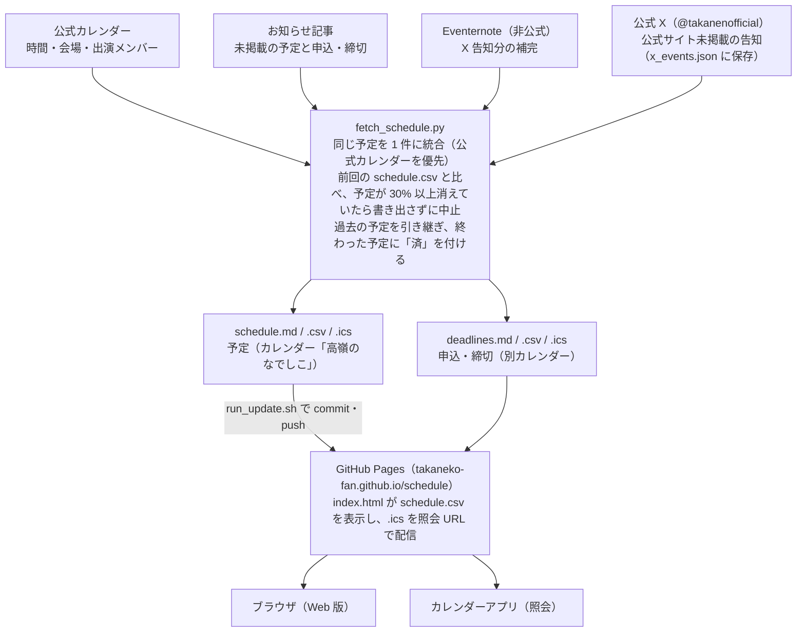

# schedule 仕様書

作成日: 2026-10-21

## 概要

高嶺のなでしこ（たかねこ）の出演・イベント予定を公式サイトなどから自動で集め、メンバー別のスケジュール一覧とカレンダー（iCalendar）を出力するファン向けの非公式ツールです。

| 項目 | 内容 |
| --- | --- |
| 対象ユーザー | 予定をカレンダーアプリで追いたいファン |
| 公開リポジトリ | [takaneko-fan/schedule](https://github.com/takaneko-fan/schedule) |
| 公開サイト | https://takaneko-fan.github.io/schedule/ （GitHub Pages） |
| 動作環境 | Python 3.10 以上、標準ライブラリのみ |
| 位置づけ | 非公式。予定は取得時点のもので、参加前に公式サイト・公式 X で確認が必要 |

## 全体構成



処理はすべて `fetch_schedule.py` 1 本で行い、`run_update.sh` が実行から push までをまとめます。申込・締切はお知らせ記事だけから読み取り、公式 X・Eventernote の取得に失敗しても処理は続行します（公式 X は保存済みの予定を使う）。

会場が「東京都内某所（詳細は後日発表）」のような未定の予定は、同じ日付で始まる記事（`【10月24日(土)】… at ベルサール西新宿 当日販売のお知らせ` など）のタイトルの「at 会場名」や本文の「【会場】」「会場：」から会場名を補います。イベント名に共通の語句がある予定だけを対象にし、新しい記事を優先します。補った記事は `venue_url` に残し、カレンダーのメモ欄（「会場の情報元」）・schedule.md の会場名のリンク・Web 版の「会場の情報元」リンクに使います。情報元（`url`）はイベントページのままにします（UID が変わらないように）。

| ファイル | 役割 |
| --- | --- |
| `fetch_schedule.py` | 取得・統合・出力のすべて（約 890 行、標準ライブラリのみ） |
| `run_update.sh` | 取得 → 差分があればコミット・push → 通知（GitHub Actions・手動兼用） |
| `notify.py` | 前後のコミットの CSV を比べ、更新の内容を ntfy で通知する（標準ライブラリのみ） |
| `remind.py` | 今日締切の申込と、今日始まる先着販売を ntfy で知らせる（たかねこリマインド） |
| `.github/workflows/update.yml` | `run_update.sh` を 1 日 8 回セルフホストランナーで実行する |
| `index.html` | GitHub Pages の Web 版（手書き） |
| `docs/flow.html` | 処理の流れの図（手書き）。処理の流れを変えたら一緒に直す |
| `tests/` | `unittest` のテスト。ネットワークにつながず AI も呼ばない（`python3 -m unittest discover -s tests`） |
| `.devcontainer/` | 開発用の Python コンテナ定義 |

## データ仕様

予定データの正本は `schedule.csv` と `deadlines.csv` の 2 つです。どちらも UTF-8（BOM 付き）で、`schedule.csv` は次回実行時に過去の予定を引き継ぐ元にもなります。

### schedule.csv（予定）

日付順で、同じ日は開始時刻順に並びます（開始時刻がなければ開場時刻、部制の予定は `time_note` の最初の時刻。時刻が分からない予定はその日の最後）。

| 列 | 内容 | 例 |
| --- | --- | --- |
| `done` | 終了済みなら「済」（開始日が今日より前） | 済 |
| `date` / `weekday` | 日付（YYYY-MM-DD）と曜日 | 2026-09-24 / 木 |
| `open` / `start` / `end` | 開場・開演・終了時刻（記載があるもののみ） | 18:00 |
| `time_note` | 部制イベントの時間 | 1部 12:30 START ／ 2部 16:00 START |
| `title` | イベント名 | ✿SPACE MAKE✿ |
| `category` | ライブ／イベント、メディア、誕生日、その他、お知らせ記事、公式X、Eventernote（非公式）。番組なら「 / ラジオ」「 / テレビ」「 / 配信」、AI が読み取った予定なら「 / AI読み取り」が続く | その他 |
| `members` | 出演メンバー（「、」区切り）。個別の記載がなければ「グループ（全員）」 | 城月菜央、松本ももな |
| `venue` | 会場 | |
| `url` | 情報元のページ | |
| `venue_url` | 会場を別の記事から補った場合、その記事（それ以外は空） | |
| `memo` | 参加メモ（AI による要約。1 行 1 項目、最終行は注意書き） | 📍 会場: ベルサール西新宿… |
| `uid` | 予定の ID。日付と url から作る SHA-1 の先頭 16 桁（同じ日・同じ url が複数あればタイトルを混ぜて作り直す。`assign_uids`）。過去の予定は前回の CSV の値をそのまま使う。情報元が変わった予定は前回の ID を引き継ぐ（下記「ID の引き継ぎ」）。iCalendar の UID、Web 版の印、`events/<uid>.ics` に使う | 070bcf4a728c51f6 |

#### ID の引き継ぎ

情報元が変わると（公式 X・Eventernote → 公式カレンダー、イベントページ → お知らせ記事など）url から作る ID も変わり、カレンダーの予定が作り直され、Web 版の「行く」の印も外れてしまう。これを防ぐため、`assign_uids` は前回の `schedule.csv` を見て ID を引き継ぐ。

1. いつもどおり日付と url から ID を作る。前回の CSV に同じ ID があればそのまま使う。
2. 前回になかった ID の予定は、前回あって今回消えた予定のうち、**同じ日付**で**タイトルに 4 文字以上の共通部分があるか会場が同じ**もの（`same_event`）を探し、その ID を引き継ぐ。公式 X の予定が統合された予定は、元の投稿の URL（`x_urls`）が前回の予定の url と同じものも対象にする（「個別握手会／東京都内某所」→「…リリース記念個別イベント／大崎ブライトコアホール」のように予定名・会場が変わっても引き継げる）。実行ログに `= ID を引き継ぎ` と出す。
3. 取り違えを防ぐため、候補が 2 件以上ある場合や、同じ候補に当てはまる新しい予定が 2 件以上ある場合は引き継がない（`! ID を引き継がず` と出す）。
4. 日付が変わった予定（延期など）は対象外。別の公演と取り違える危険が大きいため。

### deadlines.csv（申込・締切）

| 列 | 内容 |
| --- | --- |
| `done` | 済フラグ（schedule.csv と同じ） |
| `date` / `weekday` / `time` | 日付・曜日・時刻（時刻がなければ空） |
| `kind` | 種別：受付開始、受付締切、当落発表、入金締切、一般発売 |
| `event` | イベント名（記事タイトルから「高嶺のなでしこ」を除いたもの。日付付きの記事は「10/24 …」のように開催日を前置） |
| `detail` | 受付の区分（「FC先行受付」など記事中の見出し。なければ検出した見出し語） |
| `note` | 記事に書かれていた日時の原文 |
| `url` | 情報元の記事 |
| `label` | 何の期限か（「抽選の締切」「先着販売の開始」「オフィシャル先行受付の締切」「入金締切」など。`deadline_label`） |
| `time_text` | 時刻の表記（「21:00〜」「23:59まで」。締切の時刻がなければ「各部開始10分後まで」のような記事の表記） |
| `event_short` | アルバム名などを除いた短いイベント名（「11/20 発売記念オンラインサイン会」） |

Web 版の申込・締切の一覧、たかねこリマインド、`deadlines.md`・`deadlines.ics` の予定名は `label`・`time_text`・`event_short` を使います。Web 版では、1 つの予定に別々のイベント（サイン会とお話し会など）の申込が結び付いているとき、共通部分を除いた名前（「サイン会」「お話し会」）を添えます。

### メンバー定義

メンバーは `fetch_schedule.py` の `MEMBERS` に公式サイトの掲載順で定義しています（城月菜央、涼海すう、橋本桃呼、葉月紗蘭、東山恵里沙、日向端ひな、松本ももな、籾山ひめり）。メンバーが変わったときはここを更新します。

## 出力仕様

1 回の実行で 6 つのファイルと `events/` を書き出し、`index.html` が `schedule.csv`・`deadlines.csv`・`events/` を読んで画面に表示します。

| ファイル | 用途 | 備考 |
| --- | --- | --- |
| `schedule.md` | メンバー別・日付順の一覧（読む用） | 終了済みは ✅ |
| `schedule.csv` | 加工用・Web 版のデータ源 | 過去分の引き継ぎ元 |
| `schedule.ics` | カレンダー「高嶺のなでしこ」 | 照会 URL: https://takaneko-fan.github.io/schedule/schedule.ics |
| `deadlines.md` | 申込・締切の一覧 | |
| `deadlines.csv` | 同じ内容の CSV | |
| `deadlines.ics` | カレンダー「高嶺のなでしこ 申込・締切」 | 照会 URL: https://takaneko-fan.github.io/schedule/deadlines.ics |
| `events/<uid>.ics` | これからの予定 1 件ずつ（Web 版の「カレンダーに追加」用） | 下記 |
| `x_events.json` | 公式 X の告知から読み取った、これからの予定 | 下記「公式 X の告知」。投稿は一度しか読まないので保存する |
| `index.html` | GitHub Pages の Web 版 | 手書き。生成対象ではない |

`events/` は `write_event_files` が書き出します。

- 対象はこれからの予定（`done` が空）だけ。終わった予定・一覧から消えた予定のファイルは削除する。
- 変換ルールは `schedule.ics` と同じ（`ics_event` を共用）。ただし UID は `<uid>@takaneko-data-mine` にし、照会カレンダーの予定と別のものとして扱わせる。カレンダー名・更新間隔（`X-WR-CALNAME`・`REFRESH-INTERVAL`）は付けない。
- 内容が前回と同じファイルは書き直さない（`write_calendar` の比較を使う）。GitHub Pages は `.ics` を `text/calendar` で返すので、iPhone の Safari でリンクを押すとカレンダーへの追加画面が開く。

### iCalendar の変換ルール

| 元データ | カレンダー上の予定 |
| --- | --- |
| 開演（または開場）時刻あり | 開演から。終了時刻がなければ 2 時間 |
| 部制（`time_note`） | 最初の部の開始〜最後の部の終了（不明なら最後の部の開始 + 2 時間） |
| 時刻なし | 終日の予定 |
| 個別メンバーの出演 | タイトル先頭に【城月・松本】のように姓を付ける |
| Eventernote（非公式） | 末尾に「（非公式）」、ステータス「仮」 |
| 申込・締切 | 「【受付締切】イベント名（区分）」。締切はその時刻に終わる 30 分、他はその時刻から 30 分。時刻なしは終日 |

- 時刻は日本時間（Asia/Tokyo）。予定は「空き時間」扱いで、個人の予定の空き状況に影響しません。
- 開場時刻・部ごとの詳細・出演メンバー・情報元 URL はメモ欄に入ります。
- UID は日付と URL のハッシュで、照会側で予定が重複しません。更新間隔の目安は 6 時間（`REFRESH-INTERVAL`）です。
- 内容が前回と同じなら `.ics` は書き直しません（実行時刻だけの差分でコミットが生まれないようにするため）。

### Web 版（index.html）

`schedule.csv` を読み込み、メンバー・カテゴリで絞り込んで表示します。メンバーを選んだときに「グループ（全員）」の予定を含めるか、終了済みを表示するかを切り替えられます。両カレンダーの照会ボタン（`webcal://`）と URL も載せています。

#### 行く予定（★）

| 機能 | 仕様 |
| --- | --- |
| ☆ 行く | これからの予定（今日を含む）だけに表示。押すと uid を「行く」に入れる。終わった予定にはボタンを出さない |
| ★ 行く予定だけ | 「行く」の予定のうち、これからのものだけを表示する。この間はメンバー・カテゴリの絞り込みを使わない |
| 画面下のバー | これからの「行く」が 1 件以上あるときだけ表示（`position: fixed`、iPhone のホームバーの分を空ける）。件数・まとめて追加・追加済みの印を消す・移すリンクを並べる |
| 申込・締切 | 予定ごとに関係する `deadlines.csv` の行を折りたたみで表示（下記）。「行く」の予定で、まだ先の項目があれば最初から開く。過去の項目は取り消し線、次の項目は太字 |
| カレンダーに追加 | これからの予定に `events/<uid>.ics` へのリンクを付ける。押すと「追加済み」に入れ、表示を「カレンダーに追加済み」にする |
| まとめてカレンダーに追加 | 「行く」かつ未追加のこれからの予定の `events/<uid>.ics` を読み込み、VEVENT をつないで 1 つの `.ics`（`takaneko-going-<日付>.ics`）として保存させる。保存後、それらを「追加済み」に入れる |
| 追加済みの印を消す | これからの「行く」の予定の「追加済み」をすべて消す |
| 移すリンク | これからの「行く」の uid を `#going=uid.uid…` に入れたリンクをコピーする。開いた側は「行く」に追加し（既存は消さない）、`#` 以降を URL から消してお知らせを出す。「追加済み」は移さない |

印の保存と片付け:

- 「行く」と「追加済み」は localStorage（`takaneko-schedule-going`、`takaneko-schedule-added`）に uid の配列で保存する。サーバーには送らない。端末・ブラウザごとに別。
- `schedule.csv` を読み込んだとき、終わった予定と一覧にない uid を両方から捨てる（`pruneMarks`）。
- ★ を外しても「追加済み」は残す。付け直してまとめて追加したときに二重登録しないため。ページからはカレンダーの予定を消せないので、行かなくなった予定は利用者がカレンダーアプリで消す（README に記載）。

#### 申込・締切の結び付け（自動で判定）

`deadlines.csv` の `event` と予定の `title` を、「高嶺のなでしこ」「たかねこ」・空白・記号を除いて NFKC で正規化し、最長の共通部分文字列の長さで判定します。

- 申込・締切の日付が予定の日付より後、または 150 日より前のものは対象外。誕生日の予定には結び付けない。
- `event` が「10/24 …」のように開催日で始まる場合は、その月日が予定の日付と一致し、かつ共通部分が 6 文字以上。
- 開催日が付いていない場合は、共通部分が 8 文字以上。
- 表示には「自動で読み取り、自動的に結び付けている。申し込む前に受付ページを確認」の注意書きを付ける。

## 申込・締切の抽出

公式サイトのお知らせ記事（WordPress REST API、既定で過去 365 日分）を 1 行ずつ読み、「受付期間」などのラベルの後ろにある日時を種別ごとの予定にします。

| ラベル（正規表現の要旨） | 最初の日時 | 最後の日時 |
| --- | --- | --- |
| ○回目受付、受付／応募／抽選予約販売／先着販売／販売期間 | 受付開始 | 受付締切 |
| 受付締切、申請締切、締切 | 受付締切 | — |
| 当落・入金期間、抽選結果確認／入金期間 | 当落発表 | 入金締切 |
| 抽選結果（発表）、当選連絡 | 当落発表 | — |
| 当選分お支払い期限、支払期日、支払締切 | 入金締切 | — |
| チケット一般発売 | 一般発売 | — |
| 販売開始（LINE・オンライン・Web・ストア・サイトのみ） | 受付開始 | — |

### 読み取りの規則

1. 記事本文を NFKC で正規化し、行ごとにラベルを探す。その行に日時がなければ次の行を見る。
2. 期間ラベルで「〜で 23:59まで」のように終わりだけ書かれていれば、その日時を終わりの種別（受付締切など）にする。
3. 直前の見出し（【…】、■…、☆… など）のうち「受付・先行・抽選・予約・販売・特典会名」を含むものを区分（`detail`）にする。
4. 記事タイトルが「【10月24日(土)】…」のように始まる場合は、イベント名に開催日を付けて同名の別の回と区別する。
5. 種別・日時・イベントが同じものは 1 件にまとめる（新しい記事の記載を優先）。

### 除外するもの

- 店舗の電話受付時間、会場での当日販売（「受付時間」「当日」「会場」を含む行）
- 支払方法ごとの締切（見出しに「振込・ペイ・カード・コンビニ・決済」を含むもの）
- 記事の公開日より前の日付。ただし終わりが公開日以降の期間（受付期間の途中で公開された記事）は、始まりも残す。公開から 30 日（`WARN_DAYS`）以内の記事で見つかった場合は公式の記載ミスの可能性として実行ログに警告を出し、ntfy でも知らせる（下記「記載ミスの可能性の通知」）
- FC サイトやプレイガイドにしか載っていない受付、「翌日15:00まで」のような相対的な書き方の締切（読み取れない）

## 公式 X の告知

公式 X（@takanenofficial）の投稿から予定を読み取り、公式サイトにまだ載っていないものを予定一覧に加えます（`category` は「公式X」、`url` は投稿の URL、ステータスは確定）。メンバー個人のアカウントは対象外です。

| 項目 | 内容 |
| --- | --- |
| 取得 | X API v2 の `GET /2/users/:id/tweets`（リポスト・返信を除く）。トークンは `.env` か環境変数の `X_BEARER_TOKEN` |
| 読む範囲 | 前回読んだ最新の投稿より新しいものだけ。初回（記録がないとき）は 7 日前から。1 回 300 件まで |
| 記録 | 前回読んだ最新の投稿 ID（`since_id`）と、AI 読み取りに失敗した投稿 ID（`pending`）を `~/.local/state/takaneko-fan/x_state.json` に保存（環境変数 `X_STATE_PATH` で変更可）。Actions の checkout で消えないようリポジトリの外に置き、コミットしない。手元と VPS で記録は別々 |
| 料金 | 従量課金で投稿 1 件 $0.005。同じ投稿を同じ日（UTC）に読み直しても 1 回分 |

読み取りの規則（`extract_x_candidates`）：

- `🗓️11月14日(土)` のように日付だけの行を予定の日付とし、その下の空行までを 1 件分とみなす。予定名はその最初の行（`📍`・`⏰` などの行を除く）、なければ投稿の『』「」内。会場は `📍` の行、時間は `OPEN`/`START`・`⏰` の行。
- 日付のない `#あしたのたかねこ`（投稿日の翌日。日本時間 5 時より前の投稿は前日の夜の投稿とみなし、投稿日当日）、`このあと`・`本日`（投稿日）の投稿は、その次の段落を予定名にする。販売・受付の告知かどうかはこの予定名で判断する（本文の「受付終了」などでは除外しない）。
- 予定名・時間からは絵文字を外し、全体が『』で囲まれた予定名は『』を外す。`1部` と時間が別の行に書かれていればつないで読む。
- 除外: 期間（日付が 2 つある行・`~` で始まる時間）、`🗓️発売日` のような見出しの下や販売・受付などの告知（お知らせ記事と同じ語）、文中の日付、投稿日より前の日付。
- 予定名がその下にないときは、日付行の直前の段落の『』、なければ投稿の『』「」を使う（`＼…／` の呼びかけ行は予定名にしない）。
- ライブ後のお礼投稿（`ありがとうございました` を含む）の `このあと…` は、その日の予定の続き（物販など）なので拾わない。
- `🗓️` 付きの日付行で会場か時間が読めたものを `◎`、それ以外を `?（要確認・公開しない）` としてログに出す。
- 読み取りが正しいかの目安として、各候補に `[公式に掲載済み]` / `[公式に未掲載]` を付ける。公式カレンダー・お知らせ記事（Eventernote は除く）に、同じ日付で `same_event` に当たるか、会場名の一方がもう一方を含む（「汐留シオサイト」と「汐留シオサイト地下歩道 特設ステージ」）予定があれば掲載済み。最後に `◎ N 件（うち公式に掲載済み M 件） / ? K 件` を出す。
- `--x-recheck DAYS` で、前回の続きではなく DAYS 日前から読み直せる（前回の続きの記録は変えない。読んだ件数分の料金がかかる）。読み取った予定は `x_events.json` に保存するので、初回の取り込みにも使う。

2026-10-28 に 30 日分（143 件）で確認した結果：◎ 63 件のうち 57 件が公式に掲載済みで、日付・予定名の読み違いはなかった。未掲載 6 件は、公式カレンダーにないラジオ・配信の出演 4 件と、会場が `東京都内某所` のまま告知された個別イベント 2 件（公式では会場名・予定名が異なるため一致と判定できない）。

### 保存（`x_events.json`）

投稿は一度しか読まないので、予定一覧に入れる予定を保存し、毎回の実行で使います（`run_update.sh` でコミット）。

- 保存するのは `◎` のうち、当日の告知（`このあと`・`本日`）を除いたもの。当日の告知はメンバーの今いる場所を公開しないため、ログに出すだけにする。ただし会場のないラジオ・テレビ・配信の番組は、公式の告知どおりで居場所を新たに知らせることにならないので、当日の告知でも保存する（`x_publishable`）。
- 1 件の中身: 日付、予定名、会場、`open`/`start`/`end`、`time_note`、出演メンバー（本文にフルネームがあるメンバー。全員か 0 人なら「グループ（全員）」）、投稿内の『』の名前（`names`。公式の予定との照合用）、投稿の URL・ID・投稿日時。
- 投稿の本文は保存しない（公開リポジトリに告知文を転載しないため）。
- 同じ投稿・同じ日付の予定は、読み直した内容で置き換える。日付が今日より前になった予定は消す（過去の予定は `schedule.csv` から引き継ぐ）。
- X の取得に失敗したときやトークンがないときも、保存済みの予定は使う。

### AI 読み取り（ルールで読めなかった投稿）

「明日オンエア」のように書式の決まっていない投稿は、ルール（`extract_x_candidates`）では予定を取り出せないため、LLM（参加メモと同じ `MEMO_MODELS`）で読み取ります。読むのは LLM、公開してよいかを決めるのはコードです。API キーがなければ読み取りを飛ばします。

| 処理 | 内容 |
| --- | --- |
| 対象 | 確実な候補（`sure`）がルールから出なかった投稿の読み取りを採用する。読めた投稿も LLM に読ませ、結果の日付の比較を実行ログに出すだけで採用しない（ルールの廃止を判断するため） |
| 日付 | LLM は `when`（tomorrow / today / date / unknown）と本文の日付の表記だけを返し、コードが計算する |
| 検証（`x_llm_reject`） | 当日の告知（会場のない番組を除く）・日付が決まらない・範囲外（投稿日より後から 366 日以内のみ）・予定名、時刻、会場、放送局、メンバーが本文にない・開始時刻がない（放送局のある番組を除く）・販売や受付の告知は採用しない。理由を実行ログに出す |
| メンバー | LLM が予定ごとに返し、本文に実在するフルネームだけを受け付ける。空なら全員（1 投稿に出演者の違う予定が並ぶため） |
| 表示 | `category` に「AI読み取り」を足す。放送や配信の番組は、統合の後に放送局を予定名の末尾に（）で足す |
| 失敗時 | LLM の呼び出しに失敗した投稿の ID を `x_state.json` の `pending` に残し、次回読み直す（1 件 $0.005）。`X_LLM_MAX_TRIES` 回で諦める |

検証は語の組み合わせの間違い（番組 A の時刻を番組 B に付けるなど）までは防げません。元の投稿は `url` から確認できます。投稿の本文は保存しません。

### お知らせ記事の AI 読み取り（`post_llm_rows`）

「リリースキャンペーンスケジュール」のように、日付の見出しの下に「時刻 → 出演者 → 局「番組」」が並ぶ記事は、ルール（`extract_post_items`）では予定を取り出せません。ルールで予定が 1 件も出なかった記事を、公式 X と同じ LLM・指示文で読み、同じ検証（`x_llm_reject`。投稿日の代わりに記事の公開日を使う）を通った予定を使います。

| 項目 | 内容 |
| --- | --- |
| 一覧に入れる予定 | ラジオ・テレビ・配信の番組だけ（`media` があるもの）。ライブや特典会は公式カレンダーにあることが多く、予定名の書き方が違うと二重に載るため、読み取りの記録だけにする |
| 保存 | `post_ai.json` に記事ごとの本文のハッシュと読み取った予定を保存（コミットする）。本文が変わらなければ読み直さない。記事の本文は保存しない |
| 読み直し | 記事の本文、モデル、`POST_AI_VERSION` のどれかが変わったとき。1 回の実行で `POST_AI_MAX_CALLS` 件まで |
| 表示 | 種別は「お知らせ記事 / ラジオ / AI読み取り」。参加メモは作らない |
| 費用 | 初回（1 年分のルールで読めない記事 56 件）で約 $0.05。以後は記事が増えた・変わった分だけ |

### 番組の種別（ラジオ・テレビ・配信）

番組の予定は `category` に種別を足し（例: `公式X / ラジオ`）、Web 版のタグと絞り込みに出します。`title` はそのままにして、カレンダー・`schedule.md`・Web 版・通知の表示で先頭に【ラジオ】のように付けます（予定の統合や ID に影響させないため）。

- `MEDIA_PROGRAMS` の語を予定名に含む予定は、その種別にします。投稿の語句より優先し、公式の予定や、引き継いだ過去の予定にも効きます。種別を空にすると、配信とリアルイベントを兼ねる予定などを番組として扱いません。
- 公式 X の予定は、投稿に `MEDIA_WORDS` の語があれば種別を判定し、結果だけを `x_events.json` の `media` に保存します。
- 会場のある予定と、オンラインのサイン会・お話し会などは判定しません（配信付きのライブなどを番組にしないため）。

### 統合（`merge_post_rows`）

公式カレンダー → お知らせ記事 → **公式 X** → Eventernote の順に統合する。公式 X の予定は古い投稿から順に、次のどれかに当たる同じ日の予定があれば 1 件にまとめ、なければ追加する（実行ログに `+ 追加（公式X）`）。

- お知らせ記事と同じ条件（予定名・会場に 4 文字以上の共通部分）
- 投稿内の『』の名前と予定名に 8 文字以上の共通部分（グループ名「高嶺のなでしこ」7 文字だけでは一致させない）
- 会場名の一方がもう一方を含む

統合先の候補が 2 件以上ある場合は、取り違えないよう追加も統合もせず `! X の予定を統合せず` と出す。公式の予定にまとまったときは、元の投稿の URL を `x_urls` に残し、ID の引き継ぎと安全策（予定が消えたかの判定）に使う。同じ予定を告知した別の投稿は先の投稿の予定にまとめ、空いている時間・会場を後の投稿で埋める。

公式 X の予定には参加メモを付けない（材料となる本文を保存しないため）。公式サイトに載って統合されればメモの対象になる。

### 中止・欠席の告知（`x_notices.json`）

2025-12 以降、中止・欠席は公式 X だけで告知され、公式サイトのお知らせ記事にも公式カレンダーにも反映されない（カレンダーの予定は残り、注記もない）。そのため、公式 X の告知を読んで予定に印を付ける。

| 項目 | 内容 |
| --- | --- |
| 見分け方（`x_notice`） | 1 行目が「○○欠席のお知らせ」「【○○欠席のお知らせ】」「【イベント中止のお知らせ】」「【公演中止のお知らせ】」「【ミニライブ中止のお知らせ】」などの投稿（`X_NOTICE_RE`）。告知の投稿は新しい予定として読まない（AI にも渡さない） |
| 読み取り | 日付は本文の「6/27(土)」、なければ「本日」（投稿日）・「明日」。日付が読めなければ使わない。予定名は本文の『』「」の中。欠席するメンバーは 1 行目（なければ本文）のフルネーム、代わりのメンバーは「○○に変わり、△△が出演」 |
| 種類 | 「イベント・公演・開催・ライブ」の中止（または語なし）は中止、それ以外（ミニライブなど）は一部の中止、欠席 |
| 保存 | `x_notices.json` に日付・種類・印・予定名・メンバー・投稿の URL・投稿日時を保存（コミットする）。投稿の本文は保存しない。日付が過ぎたら消す |
| 反映（`apply_x_notices`） | 統合の後、同じ日付の予定（誕生日を除く）のうち、予定名が告知の『』「」の名前と 6 文字以上一致するものに、予定名の先頭へ【中止】【ミニライブ中止】【城月欠席】を付ける。一致がなく、その日の予定が 1 件だけならその予定に付ける。決まらなければ実行ログに出すだけ |
| 欠席のメンバー | 個別メンバーの予定なら、欠席するメンバーを外して代わりのメンバーを足す。グループ（全員）の予定はそのまま |
| カレンダー | 【中止】の予定は `STATUS:CANCELLED`。予定名は【中止】などを先頭にしたまま、個別メンバーの【城月】などをその後に付ける |
| 通知 | 予定名に【中止】【城月欠席】などが新しく付いたら、重要な変更「⚠️ 中止 11/14 イオンモール津田沼」として知らせる |

2025-11〜2026-11 の実際の告知 11 件のうち、日付と予定名を読み取れたのは 10 件（読めなかったのは本文がリンクだけの 1 件）。

### 変更・中止の告知の AI 読み取り（`x_change_read`）

時刻・会場の変更（「【開場/開演時間変更のお知らせ】」「📢お知らせ📢 … タイムテーブルの変更がございます」など）や、1 行目が決まった形でない中止・欠席は、書き方が決まっていないため AI で読む。読むのは AI、使うかどうかを決めるのはコード。API キーがなければ読まない（1 行目が決まった形の中止・欠席はルールで読む）。

| 処理 | 内容 |
| --- | --- |
| 対象 | 1 行目が決まった形の告知（`x_notice`）以外で、本文に「変更・中止・欠席・延期・見合わせ・振替・お休み・繰り上げ・繰り下げ」を含む投稿（`X_CHANGE_WORDS_RE`）。新しい予定の読み取りとは別に読む。1 年で月 2〜3 件ほど |
| AI に渡すもの | 投稿の本文と投稿日時、投稿日の前日から 120 日後までの予定の一覧（番号・日付・予定名・会場・時刻） |
| AI が返すもの | 種類（change・cancel・partial_cancel・absent・postpone・caution・other）、一覧の番号、日付の表記、変わった項目と変更後の値、欠席するメンバー、中止の内容、根拠の一文 |
| 検証（`x_change_reject`） | 注意書き（caution）とそれ以外（other）は使わない。根拠の一文が本文にあり、種類に合う語（中止・欠席・延期・変更など）を含み、「場合」「可能性」「予定通り」「変更はございません」を含まないこと。番号が一覧になければ、その日の予定が 1 件のときだけそれにする。日付の表記から計算した日付が予定の日付と一致し、終わった予定でないこと。日付がなければ予定名か会場が本文にあること。変更後の時刻・会場・時間が本文にあること。欠席するメンバーと中止の内容が本文にあること |
| 変更前の値 | AI ではなく、読んだ時点の予定の値を記録する。同じ項目の変更（出演と物販の時間など）は 1 つにつなぎ、読んだ時点の値と同じ項目は捨てる（すべて同じなら使わない） |
| 保存 | ルールの告知と同じ `x_notices.json` に、種類・印・対象の予定（日付・予定名・情報元）・変更前と変更後の値を保存する（`ai: true`） |
| 反映 | 中止・一部の中止・欠席・延期は、対象の予定（情報元か予定名が同じもの）にルールの告知と同じ印を付ける（延期は【延期】で、カレンダーでは `STATUS:CANCELLED`）。変更は、予定の値が変更前のままなら変更後の値に書き換え、すでに変更後の値なら何もしない。どちらとも違えば公式が後から変わったとみなし、公式の値を使って実行ログに出す |
| 通知 | 書き換えた時刻・会場は、今の通知の判定で「⚠️ 時刻変更」などになる |
| 失敗時 | 呼び出しに失敗した投稿は、新しい予定の AI 読み取りと同じく `pending` に残して次回読み直す |

2026-06〜09 の実際の投稿 7 件で確認した結果（約 0.8 円）：卒業公演の開場・開演の変更、idoLove You のタイムテーブルの変更、有明のミニライブの中止は採用。「天候次第で中止となる場合があります」「予定通り開催します」は注意書き、振替の案内は対象外、「内容に一部変更がございます」（中身はリンク先）は変更の内容がないとして使わなかった。

### この段階でやらないこと

- 振替・延期の新しい日付（元の予定に【延期】を付けるところまで。新しい日付の予定は、新しい告知として読む）
- 本文に中身がない変更の告知（「内容に一部変更がございます。詳細はこちら」のようにリンク先にしか書かれていないもの）
- 公式 X からの申込・締切の読み取り

## 参加メモ

これからの予定に、公式の案内を AI で要約した「参加メモ」（`memo` 列）を付けます。当日に必要なことを漏れなくまとめるのが目的で、案内文の転載はしません。

### 材料（AI に渡すもの）

すべて公式サイトに公開されている文章です。個人情報や API キーは送りません。

| 取得元 | 内容 |
| --- | --- |
| 公式カレンダーのイベントページ | その予定の詳細ページの本文 |
| お知らせ記事 | 次のいずれかに当てはまる記事（`related_posts`）<br>・情報元（`url`）または会場の情報元（`venue_url`）の記事<br>・タイトルが【開催日】で始まり、イベント名に「高嶺のなでしこ」以外で 5 文字以上の共通の語句がある記事<br>・タイトルに日付がなく、本文に開催日が書かれ、イベント名に共通の語句がある記事（「2026年11月18日(水)発売」のような発売日の記載は開催日とみなさない） |
| 予定の基本情報 | イベント名・日付・曜日・会場 |

渡す前に、個人情報の取り扱い・第三者提供・反社会的勢力の条項・問い合わせ先・電話番号・受付時間・メールの受信設定・URL だけの行を除きます（`MEMO_BOILERPLATE_RE`）。文章は最大 3 万字です。

### メモの項目

AI には JSON スキーマで次の 10 項目を返させます（`MEMO_FIELDS`）。表示はこの順です。

| 項目 | 表示 | 内容 |
| --- | --- | --- |
| `venue` | 📍 会場 | 会場名と住所 |
| `flow` | 🕙 当日の流れ | 販売開始・開場・開演・各部の開始などの時系列 |
| `parts` | 👥 部とメンバー | 部ごとの時間とメンバー（同じメンバー構成の部はまとめ、メンバーは姓のみ） |
| `join` | 🎫 参加方法・当日券 | 参加券の入手方法、当日券・当日販売の有無と場所 |
| `price` | 💴 料金 | 券種・商品と金額 |
| `payment` | 💳 支払い | 支払い方法 |
| `items` | 🎒 持ち物 | 本人確認書類・スマホ・マスクなど |
| `rules` | 📸 ルール | 撮影・握手・トークなどのルール |
| `notes` | ⚠️ 注意 | 特に注意すること |
| `other` | ℹ️ その他 | オンラインのアプリ、商品の受け取り方法、外部イベントの主催者サイトなど |

### AI への指示（`MEMO_INSTRUCTION`）

- 案内文に書かれている事実だけを使い、書かれていない項目は空にする。「記載なし」「未発表」などの説明も書かない。
- 日時・時刻・金額・枚数・締切は案内文の通りに書く。
- 各項目は 80 字程度まで（`parts`・`rules`・`notes`・`join` は 200 字程度まで）。同じ内容を複数の項目に書かない。
- 受付時間と締切、本人確認、入場条件、持ち込みの制限、再発行や払い戻しの不可、配布終了の条件、待機や整列の決まりは、短さより優先して書く。
- 案内文を長く引用せず、要点だけをまとめる。
- URL は書かない。外部イベントで主催者サイトを案内する場合だけ、そのトップページの URL を書く（takanenonadeshiko.jp は主催者サイトではない）。
- 締切が過ぎた販売・受付は書かなくてよい。

指示文を変えたら `MEMO_PROMPT_VERSION` を上げます（全メモを作り直す）。

### 後処理（`clean_memo`）

- 改行を「／」にまとめる。
- takanenonadeshiko.jp の URL を除く。
- 「後日発表」「未発表」「未定」「記載なし」「不明」「要確認」で始まる項目は空にし、「／」区切りの一部に「記載なし」などがあればその部分だけ除く。

### 対象外

過去の予定、誕生日、Eventernote（非公式）、発売日の行、材料が 80 字未満（見出しと URL の行は数えない）、「後日発表」を含み 600 字未満の予定にはメモを付けません。

### AI・保存・出力

- AI: `.env` の `OPENAI_API_KEY` があれば OpenAI（`gpt-5.6-luna`。`gpt-5-mini` は 2026-12-11 に提供終了のため移行）、なければ `GEMINI_API_KEY` で Gemini（`gemini-3.1-flash-lite`）。どちらのキーもなければ新しいメモは作らず、`memos.json` の既存のメモだけを使う。`--no-memo` でメモを付けずに出力する。
- キャッシュ: `memos.json` に `{日付|url: {hash, model, generated, memo}}` で保存。hash は指示文のバージョン・モデル・材料の文章から作り、変わったときだけ AI を呼ぶ。1 回の実行で AI を呼ぶのは最大 30 件（`MEMO_MAX_CALLS`）。失敗しても前回のメモを使って続行する。過去の予定のメモは CSV に残し、`memos.json` からは消す。
- 出力: iCalendar のメモ欄（【参加メモ】）、schedule.md の「参加メモ」節、Web 版の折りたたみ「参加メモ」（URL はリンクにする）、schedule.csv の `memo` 列。どれにも「公式の案内を AI が要約したものです。必ず情報元で確認してください。」を付ける。
- ログ: 実行の最後に、今回メモを作った予定（新規／更新）と、AI 利用料の概算（トークン数 × `MEMO_PRICES`、1 ドル 150 円で換算）を表示する。
- 費用の目安（gpt-5.6-luna）: 1 件約 0.3 円。全件の作り直しで 10 円以下、以後は記事が増えた・変わった分だけ。

## 運用手順

更新は GitHub Actions（`.github/workflows/update.yml`）が 1 日 8 回 `run_update.sh` を実行して自動で行います。予定に変化があればコミット・ push され、GitHub Pages と照会カレンダーに反映されます。すぐに更新したいときは、App の鍵がある環境で `ops/dispatch_update.sh` を実行します。

`run_update.sh` の処理：

1. `git pull --ff-only` で最新にする。
2. `python3 fetch_schedule.py` を実行する（`run_update.sh` の引数はそのまま渡る）。続けて `python3 remind.py` で今日の申込を知らせる（予定に変化がない回も実行。失敗しても続行）。
3. `schedule.*` と `deadlines.*` の 6 ファイルと `memos.json`・`events/`・`x_events.json` を `git add` する。差分がなければ「予定に変化なし」で終了。
4. `feat: YYYY-MM-DD HH:MMの登録`（日本時間の日時）でコミットし、push する。
5. `python3 notify.py` で更新の内容を通知する。通知に失敗しても `run_update.sh` は失敗にしない。

### 自動更新（GitHub Actions・セルフホストランナー）

公式サイトは国外からの REST API・管理画面（`/wp-json/`、`/wp-admin/admin-ajax.php`）へのアクセスを受け付けないため、GitHub のサーバー（主に米国）では取得できません。国内の VPS に置いたセルフホストランナーで実行します。

| 項目 | 内容 |
| --- | --- |
| 実行時刻 | 日本時間 0:17 / 9:17 / 12:17 / 16:17 / 18:17 / 20:17 / 21:17 / 22:17。公式のお知らせ記事の約 8 割が 16〜23 時台に公開され、0〜7 時台は約 2% のため（2026-11 時点の全 612 件）、夕方から夜に寄せている。VPS の systemd タイマーが GitHub App の名義で起動する（下記）。ワークフローの定時実行（`schedule`）は使わない |
| 手動実行 | App の鍵がある環境で `ops/dispatch_update.sh` を実行する。Actions の画面の Run workflow でも動くが、起動者として個人のアカウント名が公開されるので使わない |
| 実行先 | `runs-on: [self-hosted, conoha]`。ConoHa VPS 1GB（大阪、Ubuntu 24.04、Python 3.12）、ランナー名 `conoha-osaka` |
| サーバー | ランナーは専用ユーザー `runner`（sudo なし）のサービスとして常駐。ssh は鍵のみ、ufw で外からは 22 番だけ許可 |
| 権限 | `contents: write`（`GITHUB_TOKEN` で push する） |
| 同時実行 | `concurrency: update` で 1 つずつ実行し、push の衝突を防ぐ |
| API キー | リポジトリの Secrets の `OPENAI_API_KEY` / `GEMINI_API_KEY`。未登録なら既存の参加メモだけを使う |
| X のトークン | Secrets の `X_BEARER_TOKEN`。未登録なら公式 X の確認を飛ばす |
| 通知のトピック | Secrets の `NTFY_TOPIC`。未登録なら通知を送らない |
| リマインドのトピック | Secrets の `NTFY_REMIND_TOPIC`。未登録ならリマインドを送らない |
| 停止の検知 | Secrets の `HC_PING_URL`（healthchecks.io の Ping URL、`takaneko-fan@proton.me` のアカウント）。成功で `HC_PING_URL`、失敗・タイムアウトで `HC_PING_URL/fail` に連絡する。チェックは Cron `17 0,9,12,16,18,20,21,22 * * *`（Asia/Tokyo）、猶予 1 時間で、更新が 1 回抜けると知らせが届く。**VPS のタイマーの時刻を変えたら、この Cron も合わせる** |
| 失敗時 | 安全策の停止や取得エラーで実行が失敗し、GitHub から通知メールが届く。`update.yml` の最後のステップが ntfy にも優先度を上げて通知する（タイムアウトを含む） |
| 公開リポジトリの対策 | 外部からのプルリクエストのワークフロー実行は、毎回承認が必要な設定にしている |

#### VPS のタイマーからの起動

GitHub の定時実行（`schedule`）は混雑で数時間遅れたり、実行自体が抜けたりする（2026-10-26〜28 の実績で 1 日 1 回は抜け、最大 5 時間 43 分の遅れ）。また、定時実行の起動者は cron 行を最後に変更したアカウントとして公開される。手動実行（`workflow_dispatch`）は遅れないので、VPS の systemd タイマーから API でワークフローを起動する。

| 項目 | 内容 |
| --- | --- |
| 起動の名義 | 組織の GitHub App `takaneko-fan-updater`（App ID 5513246）。権限は Actions・Contents・Workflows の読み書き（Contents と Workflows は下記の push 用）、インストール先は `schedule` だけ。Actions の画面の起動者は `takaneko-fan-updater[bot]` になり、個人のアカウントを使わない |
| スクリプト | `ops/dispatch_update.sh` → VPS の `/home/runner/bin/dispatch_update.sh`。App の鍵で JWT を作り、インストールのトークン（1 時間で失効）をもらって `update.yml` を起動する |
| 鍵 | `/home/runner/.config/takaneko-fan/app.pem`（`runner` だけが読める 600）。リポジトリには入れない |
| タイマー | `ops/takaneko-dispatch.timer` / `.service` → `/etc/systemd/system/`。`OnCalendar=*-*-* 00,09,12,16,18,20,21,22:17:00 Asia/Tokyo`、`Persistent=true`（止まっていて逃した回は起動後に 1 回実行） |

確認は `systemctl list-timers takaneko-dispatch.timer`（次回の時刻）、`journalctl -u takaneko-dispatch.service`（起動の結果）。鍵を作り直したときは App の Credentials → Key pairs で新しい鍵を作り、VPS の `app.pem` を置き換えてから古い鍵を削除する。VPS が止まっている間は更新されない（再開後に逃した回を 1 回実行する）。

#### 手元からの push

個人のアカウントで push すると、公開されるリポジトリのイベント（PushEvent）、Pages のビルドとデプロイの記録に個人のアカウント名が残る。手元からの push は `ops/push_as_app.sh` で App の名義で行う（引数は `git push` と同じ。省略時は今のブランチ）。鍵は手元の `~/.config/takaneko-fan/app.pem`（VPS とは別の鍵）。push の前に `tests/` のテストを実行し、失敗したら push しない（定期の更新は `run_update.sh` の `git push` で送るので、テストでは止まらない）。うっかり `git push` しないよう、手元のリポジトリでは `remote.origin.pushurl` を存在しない場所にしてある。

ランナーが Offline になったときは、VPS で `systemctl status actions.runner.takaneko-fan.conoha-osaka` を確認します。

### 更新の通知（ntfy）

`notify.py` が直前のコミットと最新のコミットの CSV を比べ、1 回の更新につき 1 件の通知を ntfy へ送ります。iPhone の ntfy アプリで受け取り、Apple Watch にはミラーリングで届きます。

| 変更 | 通知 | 判定 |
| --- | --- | --- |
| 予定の追加 | する | 前のコミットにない `uid` |
| 予定の内容の変更（参加メモを含む） | する | `NOTIFY_IGNORE_COLUMNS`（`done`）以外の列が違う |
| 予定の削除 | する | 後のコミットにない `uid` |
| 申込・締切の追加 | する | `done` 以外の全列が一致する行が前のコミットにない。ID がないので内容の変更もここに含まれる |
| 申込・締切の削除 | しない | 古い記事が取得範囲から外れても消えるため |
| 「済」が付いただけ | しない | 比較の対象外 |
| 日本時間の今日より前の日付の行 | しない | どの変更でも除外する |

予定の変更は、見逃すと困るものを区別して書きます。

| 区分 | 対象 | 通知 |
| --- | --- | --- |
| ⚠️ 重要な変更 | 日付の変更、すでに書かれていた時刻の変更、別の会場への変更、出演メンバーの変更、削除 | タイトルを「予定の変更あり」にし、優先度を上げる（`IMPORTANT_PRIORITY`）。変更前→変更後を書く |
| ✅ 決定・追記 | 空だった時刻や会場（「東京都内某所」「後日発表」のような仮の会場を含む）が埋まった、会場の表記が詳しくなった・変わった（共通部分が 6 文字以上）、全員から個別のメンバーになった | 通常の優先度で、決まった内容を書く |
| 件数だけ | 新規、参加メモや URL などの変更、申込・締切の追加 | 今までどおり件数と予定名 |

ID は日付と情報元から作るので、日付や情報元が変わると削除と新規に見え、同じ記事・同じ日の予定が複数あると並びの変化で ID が入れ替わることもあります。予定名が違う同じ ID は別の予定とし、削除と新規のうち同じ情報元か同じ日付で予定名の近い組を、同じ予定の変更として扱います（過去 25 コミットで、重要な変更の誤検知がないことを確認）。

CSV の列が変わったコミットでは、そのファイルは比較しません。実行の失敗は `notify.py` を通さず、`update.yml` から送ります。

送らずに本文を確かめるには `python3 notify.py --dry-run --today 2026-11-02 31b5e7d~1 31b5e7d` のように実行します。

#### 記載ミスの可能性の通知（`notify.py --warnings`）

申込・締切の読み取りで、最近の記事にある公開日より前の日付（支払期日が当選連絡より前になっている、などの公式の誤記）を除外したとき、更新の通知と同じトピックに知らせます。除外した行は申込・締切に入らずリマインドも届かないので、公式の記事で正しい日付を確かめるためのものです。

| 項目 | 内容 |
| --- | --- |
| 材料 | `fetch_schedule.py` が毎回書き出す `~/.local/state/takaneko-fan/deadline_warnings.json`（`WARNINGS_PATH`）。公開から `WARN_DAYS` 日以内の記事の、除外した日付・種別・イベント・記事の URL と公開日 |
| タイミング | `run_update.sh` が予定の変化に関係なく毎回実行する（`notify.py` の更新の通知はコミットがあった回だけなので別に呼ぶ） |
| 二重送信の防止 | 送った項目を `~/.local/state/takaneko-fan/warned.json`（`WARNED_PATH`）に記事の公開日と一緒に記録し、公開から `WARN_DAYS` 日を過ぎたら捨てる。記事の取得に失敗して警告が空になった回も、記録は消さない |
| 本文 | 記事ごとにイベント名と「・入金締切 10/12(月) 23:59 ← 記事の公開日（10/14）より前」を並べ、最後に確認のお願い。1 記事ならタップでその記事、複数なら Web 版を開く。優先度は通常 |

2025-11〜2026-11 の記事 138 件では、通知の対象は 3 記事（公式の誤記 2 件と、2 次受付の記事に残った 1 次受付の日程 1 件）でした。送らずに本文を確かめるには `python3 notify.py --warnings --dry-run` を実行します。

通知は IPv4 で送ります。ntfy.sh の無料枠（1 日 250 件）は IPv6 では /64 単位で数えられ、VPS と同じネットワークの他の利用者と共有になるためです（2026-11-06 に IPv6 側で送信の覚えがない 110 件を確認し、429 で通知に失敗した）。

VPS やランナーが止まっていると更新自体が動かないので、失敗の通知も届きません。この場合は、停止の検知（healthchecks.io）が連絡の途絶えを検知して知らせます。

### たかねこリマインド（`remind.py`）

その日に申込で動く必要があるものを、更新の通知とは別の ntfy トピック（`NTFY_REMIND_TOPIC`）に知らせます。公式の「今日の予定」の告知と重ならない、締切のリマインドに絞っています。

| 項目 | 内容 |
| --- | --- |
| 対象 | `deadlines.csv` の今日の行のうち、受付締切・入金締切と、先着販売の受付開始（`detail` に「先着」） |
| タイミング | 日本時間 9 時（`REMIND_HOUR`）以降の最初の更新。0:17 の更新では送らない |
| 二重送信の防止 | 送った項目を `~/.local/state/takaneko-fan/remind_state.json`（`REMIND_STATE_PATH`）に記録する。同じ日にあとから増えた項目は、次の更新でその分だけ送る |
| 本文 | 先頭に「📅 今日（11/15）の申込」。1 件を「▶ 11/20 発売記念オンラインサイン会」と「　抽選の締切 23:59まで」の 2 行で、時刻順に書く。時刻のない締切は「時刻の記載なし」。4 件（`MAX_ITEMS`）を超える分は「ほか ○ 件は Web 版で確認してください」 |

`python3 remind.py --dry-run --now 2026-11-15T09:17` で、送らずに本文を確かめられます。

### 主なオプション

| オプション | 説明 |
| --- | --- |
| `--start YYYY-MM-DD` | 開始日（既定: 今日） |
| `--end YYYY-MM-DD` | 終了日。この日は含まない（既定: 今日から 366 日後） |
| `--no-detail` | 詳細ページを取得しない（速いが時間・会場が空になる） |
| `--post-days N` | 何日前までのお知らせ記事を確認するか（既定: 365） |
| `--md` / `--csv` / `--ics PATH` | 出力先 |
| `--deadlines PATH` | 申込・締切の出力先（拡張子なし、既定: `deadlines`） |
| `--force` | 安全策のチェックを飛ばして出力する |
| `--x-recheck DAYS` | 公式 X を DAYS 日前から読み直す。読み取った予定は `x_events.json` に保存する（前回の続きの記録は変えない） |

### 安全策

取得に失敗して予定を消したまま公開しないよう、書き出す前に前回の `schedule.csv` と比べ、次の場合はファイルを書き換えずにエラー終了します。

- 公式カレンダーから 1 件も取得できなかった
- 前回あった対象期間内の予定のうち 30% 以上（かつ 5 件以上）が見つからない（Eventernote の予定は比較しない）

本当に中止・削除された場合や期間を変えた場合は `--force` を付けて実行します。Eventernote・公式 X の取得に失敗しても、補助的な取得元なので警告を出して続行します。

### コミット名義

コミットは `takaneko-fan <bot@example.invalid>` 名義で行います。GitHub Actions ではワークフロー内で設定します。手元では、このリポジトリの `.git/config` に `user.name` / `user.email` を設定済みで、個人のグローバル設定より優先されます。新しい環境で clone したときは同じ設定をやり直します。

```
git config --local user.name "takaneko-fan"
git config --local user.email "bot@example.invalid"
```

## 情報の取り扱い

掲載するのは公開情報のうち事実情報だけで、権利者などから要望があれば速やかに削除します。

- 高嶺のなでしこ・所属事務所・各サイトの運営とは関係のない、ファンによる非公式プロジェクトです。
- 掲載するのは日時・イベント名・会場・情報元へのリンクのみ。画像や告知文の転載はしません（申込・締切の `note` は日時部分の原文のみ）。
- 各取得元の利用規約と robots.txt に沿って、サーバーに負担をかけない頻度で取得します（2026年10月時点で確認）。User-Agent に `takaneko-fan/schedule` を名乗ります。
- 公式・権利者・各サイトの運営から掲載の停止や修正の要望があれば、速やかに対応・削除します。

連絡先は `takaneko-fan@proton.me`（README と Web 版のフッターに記載）。
